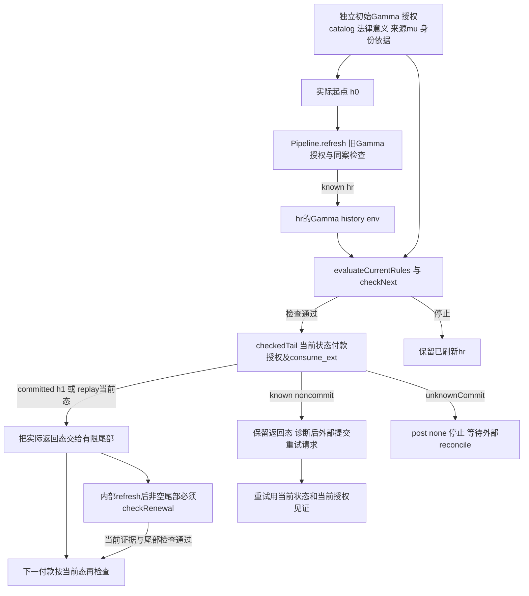

# 原题 10.6：逐边合同与已封闭终止结论的边界

**状态：SOURCE_CHANGED_MODULE_AND_RECORD_CHECKS_AND_CI_INDEX_PASS / PR_ACCEPTANCE_PENDING。** 本包只映射冻结题单 `10_授权变更与多步法律轨迹.md` L141、L143、L145；source C1 的独立模块 CI 已通过，根接入为 C2，AA 去重及 manifest 绑定为 C3。原题数学行候选登记为 COVERED；完整 records PR、exact-subject 全链与合后接受尚未发生。

接受基线 S125=`7b8e6fe25c5c04c34e2a9aed578fc1ddbc990d86`。本轮源码 `proofs/lean/juris_lean/JurisLean/Candidates/ProtocolDependencyAudit20261105.lean` 为 6565 bytes、105 行，SHA-256 `2fb8f0d5ad2bff8073b1b00a1e7034b33bec729a0316cc03c11ca9fd0244d581`；2 个新增连接定理与 26 个复用目标合计 28 对 `#check/#print axioms`。以下逐边推导以实际定义和定理合同为准，source CI 只覆盖该模块及其构建依赖，不替代完整 PR 接受。

## 有限依赖图与独立证据输入

图中 h0 是本次调用的实际起点，hr 是授权刷新实际返回状态，h1 是一次付款实际返回状态。Gamma（Γ）属于 Handle；跨付款持续，刷新时按授权替换并重新检查。图按有限 instruction list 及每个实际后态展开；重试入口不是对整个业务无限执行的终止证明。

`sourceMeaning` 在此是外部法律意义前提的说明语，不是新造的 Lean API。实际输入是 `JurisLean.Candidates.LegalActionDomain20261027.ActionMeaning`（`Candidates/LegalActionDomain20261027.lean:35`）及 `LegalInput`（同文件 L222）：meaning.gamma、steps、permissionAtoms、requiresClosed 和输入的 catalog、rules、ruleGate、policies 等。`refreshEvaluateContinue` 不从 SourceRef 自动证明这些输入的法律真实性，也不把 source bridge 的存在 fixture 当 h0 的构造算法。

下列源路径统一相对 `proofs/lean/juris_lean/JurisLean/`。表中短名按下方精确 FQN/文件行号索引展开。

## L141、L143 逐边义务

| 实际边 | 前置条件或必须执行的检查 | 后置、frame 与持续 Γ | 已有连接与不能推出的部分 |
|---|---|---|---|
| 独立证据 → 实际 h0 与语义输入 | 独立说明初始 Γ、材料解释 catalog、授权 grants、ActionMeaning、身份对应及规则/程序政策依据。若引用来源语义桥，须单独给定 μ 和 `resolveFaithful`，并有实际 `sourceModel ... = .ok out`。 | 来源桥对同一个 out 给出提取结果、关系引用的 μ 绑定及数量表示；不修改 h0。没有“accepted out 自动等于本次 h0”的假设。 | S1 提供带明确前提的同 out 语义桥；S2 证明 codec 不补足外部 μ。本协议接受显式 h0，不推定它由 source bridge 自动生成；需要把来源起点接入时须给实际数据对应，不能用存在见证替代。此处是公开输入边界，不需新增全局 source 框架。 |
| h0 → 授权刷新 hr | 实际 `Pipeline.refresh grants h0 change = .known hr`；定义执行同案检查，并以 **h0.gamma** 检查变更授权，目标含 change.gamma。 | `hr.gamma = change.gamma`，history 追加实际 event，env 按新 Γ 与新 history 计算，revision 增 1；除 history/env 外 state 保持。caseId 持续，Γ 全量不要求保持。 | A1 提取旧上下文授权及发布结果；P1 给出 `Trace.Step h0 hr`；P2 在继续路径给出 state frame。真实授权 catalog 的来源不能由这些定理自行建立；刷新成功也不保证 env 已是 known。 |
| hr → 当前规则与局部法律前提 → 首次尾部 | 实际 `evaluateCurrentRules` 检查 `input.anchor.gamma = hr.gamma` 与 `input.history = hr.state.normHistory`，然后 extractView、bindAdditional、selectedHorn；实际 checkNext 检查 meaning.gamma、permissionAtoms 和程序要求。 | 继续时 env 为 `.known selectedVersion` 且 selectedVersion 等于 hr.gamma.normVersion；规则结果是该版本上的实际 fullHorn；请求 Γ/history 与 hr 对齐；所需 permissionAtoms 在 closure 中；checkProcess 返回实际 procedure，requiresClosed 为 true 才要求 lawful closure。这些求值不改变 hr。 | P2 从 `.continued = true` 导出上述检查结果及 `payment = checkedTail grants hr meaning.steps renewals`，不从 hr 单独推出继续。补充材料、独立政策、法律规则真值与 ActionMeaning 正确性仍是输入。规则许可原子不是付款当前授权检查的替代品。 |
| 尾部当前 h → 一次实际付款 | `runTrajectory grants h [.pay req mode]` 在 h.gamma 下重新计算付款 permission，实际调用 `consume_ext h h req permission mode`。新提交的充分条件为 mode=submit、lookupReceipt=none、validationError=none；后者逐项检查当前引用、身份、positive applicability、payload scope、单位、normVersion、env、关系形成、permission、非负金额、key/cash 未用。 | 成功的 Post_i 精确给出 commitPayment 的 receipt/after 和 used key；`after.gamma = h.gamma`，revision 增 1。成功付款不是全 state frame：余额、cash、used、receipts 可改变；债项非金额字段与 formations 保持。 | G1 从实际 committed 提取 Pre_i/Post_i/current-reference/unused-key；G2 正向从 fresh+ready 得到实际 committed，避免仅有反推合同。F1 给固定字段 frame；F2 提取当前字段绑定。P2 只证明规则前置，不保证这些付款检查必过；本边依靠现成 executor 的明确检查，没有新缺引理。 |
| 实际付款返回 h1 → 有限下一步 | 仅当单步 exit=success 且 current=some actualPost，checkedTail 才把 actualPost 传给剩余 instructions；committed 使用新 h1，replay 使用当前 h。 | 下一次 consume 的 before/reference 同为实际当前状态；付款间 Γ 保持。下一请求的 identity、applicability、scope、金额单位、授权、receipt/cash 检查仍重新执行，前一步 post 不保证新请求满足它们。 | D1 明确 committed-head 到 actual-tail；D2 处理 replay；实际 checkedTail 定义见 P0。T1 从实际 reported current 导出路径、基础 invariant 和 used 单调性。不得重复读取 h0 当下一步输入。 |
| 内部 refresh → 非空剩余尾部 | 实际 refresh 返回 after；`steps ≠ []`；必须有 `checkRenewal after steps renewals = .known remaining`。新 request 的 meaning.steps 必须等于该剩余 suffix。 | P3 给新 Γ/history 对齐、实际版本/fullHorn、permissionAtoms、程序要求，并给调用等式：旧状态 refresh::steps 的 checkedTail 等于新 after/steps/remaining 的 checkedTail。该 refresh 的 frame/授权用 A1/P1；Γ 不保持原值，而是明确发布后重验。 | P3 连接实际 renewal。无 renewal、意义与 suffix 不符或检查失败均停止在 actualPost；不靠旧证据改标签继续。若尾部为空，定义直接返回 after，不存在需要检查的后续法律步骤。 |
| 已知未提交返回态 → 诊断后重试 | outcome 不是 committed，且 `outcome.post h = some returned`；rejectedNoCommit/pending/conflict 在本次停止，后续重试是新调用。不能由“非 committed”省略 some-post 条件。 | G3 得到 returned=h 的全 Handle frame，故 Γ、history、env 与其余字段均保持；修复输入后必须在**当前**状态重做实际检查。replay 可由有限尾部直接继续，但只返回当前态且不产生第二次业务 effect。 | G4 是实际 Pipeline fixture：旧上下文授权在 retryCurrent 被拒，当前授权被接受，同 key 后续 replay；I1 在显式 samePaymentId、首次 committed 与 intervening Trace.Path 下排除第二次 committed。它们不证明任意重试必成功或外部身份识别自动正确。 |
| unknownCommit → 停止 | `unknownCommit` 的 post 为 none，Pipeline.finishPayment 的 current 为 none。 | 没有可传给下一步的确定后态；G3 的返回态 frame 在此不能产生 returned=h。也不能由 acknowledgedUsed 没变证明服务器未提交。 | G5 与 P4 明确无后态。后续必须外部 reconcile 取得确定当前态和身份/receipt 信息，再进入正常检查；本模块不实现 reconcile，不宣称它成功、完整或终止。 |
| 初始规则/程序检查失败 → 停在刷新后 hr | 已有 refresh known hr，后续 continued=false。 | 保留 `payment.current = some hr`，不能回退 h0 或声称刷新未发生。 | P5 是实际失败路径的后态等式；随后重试从实际当前状态开始。 |

这里的持续 Γ 是逐边合同：付款及有返回态的 noncommit 不换 Γ；refresh 仅保留同案并用旧 Γ 的授权发布新 Γ；后继解释、版本选择和授权按新 Γ 重验。独立初始 Γ 的正当性不由“刷新后 env 自洽”循环担保。source μ、法律意义、有效授权和现实身份须有独立证据，不能让 resolver、授权结论和当前解释互相作为唯一依据。

## 三种错配的反例与最小阻断条件

1. **结构绑定被当法律适用。** M1 的两个完整 toy model 同 context、同 pay 6 文书、同 received/authentic/effective/objectMatches/scopeMatches，但 competentIssuer 分别 false/true，Obligation 分别 false/true。因此这些结构与文书属性不能单独推出义务。该模型内最小正向合同是 M2 的 `Power=true ∧ documentTrigger=true` 且满足 ModelsTheta；实际协议仍须独立正确的 ActionMeaning/规则/权限依据及当前检查，不能把 toy 定理升格为现实文书效力结论。
2. **余额归零被当程序终局。** F3 的同一实际 Acceptance.post2 同时满足 quantity=some 0、procedure=open，claim=unknown，paid=14、surplus=4。程序终局阻断条件使用 C1 的 covered、exhausted、records.id Nodup、closureAuthority 属于 validClosureAuthorities；经独立 required 列表入口时用 C2 的 validPolicy 与 exhausted。余额不在这些终局合同中。10.3 的 finalize evaluator 也不等于司法程序终局。
3. **记录 round-trip 被当来源真实。** S2 在同一个 accepted source out 上组合实际 CaseRecord codec round-trip 和 `badmu ref ≠ some observedRelation`。此处 CaseRecord 是 ConsumedView.record.value 的原对象，不以 recordOf 的定义性相等冒充 codec。最小阻断为 S1 的独立外部 μ 及 resolveFaithful：实际抽取视图中的每项成功 resolve 必须由独立 μ 确认。source bridge fixture 中从 resolver 构造的某个 μ 仅证明存在一个相容模型，不作为外部真实来源证明。

## L145 原 rank 结论及三个终止命题

原 `Final20261021/Progress.lean` 不声明具体业务事件全集：`RankedPath {S : Type} (rank : S → Nat)` 只接收每边 `rank t + 1 ≤ rank s` 的路径。R1 只推出该路径 n≤rank s；R2 只对给定 lengths 和每项≤K 的前提推出 sum≤length*K；R3 说明有限步模拟不必是一对一；R4 是 Bool 两点严格下降环的矛盾。不能把这四条定理写成“已经证明任意四核心事件，更进一步证明所有业务事件终止”。任何具体有限 DAG/event 实例只有在其状态编码和每边下降已建立时才适用。

本次实际 trace 状态是 `Ledger.Handle`，事件见 `Final20261021/Trace.lean:41`：pay、accrue、principal、writeoff、refresh、reject。协议尾部的 Instruction 只含 pay/refresh（`DecisionTrajectoryConsumer20261027.lean:28`），也不因此获得业务全局下降量。新增 R5 直接以 `Trace.Step.reject Acceptance.opening` 构成自环，并实例化 C5：任意 Nat rank 都不能在**全部**实际 Trace.Step 上严格下降。这已是最小扩展反例；无需新增撤销框架或重复证明 rank 定理。新增撤销/更新/重试若仍希望使用原严格下降界，必须逐边证明下降，或把零步停顿从被计数的业务进展关系中明确分离并另给有限停顿依据；本轮没有该无界业务合同，不能假定它成立。

| 命题 | 本轮能说明什么 | 不能混同的结论 |
|---|---|---|
| 有限验证器/有限输入程序返回 | inspect 的有限结构检查和 checkedTail 在给定有限 instructions 上结构递归；缺证据、冲突或 unknown 可作为返回结果。C6 同时展示 inspect 返回与无限 retryStep path。 | 返回不等于 accepted、lawful closure 或真实法律判断正确；也不等于所有未来调用终止。 |
| 每条业务执行终止 | C3/C4 仅在实际 step 每边严格下降时给有限步界及排除无限路径。R5 说明全部 Trace.Step 不满足这一前提。 | 本轮无无条件业务终止结论，有限图和已返回的一条轨迹不提供该结论。 |
| 现实证据搜集结束 | 当前程序的 closedLawfully 依赖明确政策/覆盖/耗尽/闭合授权。C7 给同一当前记录两种不同未来扩展；C8 排除从当前空记录推出所有未来不可能支持。 | 检查结束、程序闭合或当前材料不足均不证明未来证据不可能出现。 |

完整 `FiniteTraceInvariantAudit20261105.I` 的初始化和实际协议后态结论只限 `Acceptance.opening` 固定实例（F4）。通用 frame、executor、Trace.Invariant 与路径定理仍按各自实际前提使用；不声称所有 sourceThenProtocol 起点满足完整 I。

## 具名源码定位

以下索引是实际复用点，包含说明逐边合同所需的公开定义/定理；它不是额外的本轮 28-target CI 清单。目标清单以 r2 源文件为准。

| 代号 | 精确 FQN | 源文件与行号 |
|---|---|---|
| S1 | `JurisLean.Candidates.SourceFinalBridge20261102.source_model_joint_semantic_quantity` | `Candidates/SourceFinalBridgeAudit20261102.lean:23` |
| S2 | `JurisLean.Candidates.ProtocolDependencyAudit20261105.actual_record_roundtrip_does_not_supply_external_reference` | `Candidates/ProtocolDependencyAudit20261105.lean:24` |
| S3 | `JurisLean.Seams.UnifiedNeedlesS0S1.caseFragment_roundTrip` | `Seams/UnifiedNeedlesS0S1.lean:195` |
| A1 | `JurisLean.Candidates.AuthorizationClosureAudit20261104.actual_refresh_requires_old_authority` | `Candidates/AuthorizationClosureAudit20261104.lean:141` |
| P0 | `JurisLean.Candidates.U10_1RefreshRuleProtocol20261030.checkedTail` | `Candidates/U10_1RefreshRuleProtocol20261030.lean:106` |
| P1 | `JurisLean.Candidates.Final20261021.Pipeline.u10_1_authorized_refresh_is_step` | `Candidates/Final20261021/Pipeline.lean:64` |
| P2 | `JurisLean.Candidates.U10_1RefreshRuleProtocol20261030.continued_protocol_refines_actual_calls` | `Candidates/U10_1RefreshRuleProtocol20261030.lean:358` |
| P3 | `JurisLean.Candidates.U10_1RefreshRuleProtocol20261030.internal_refresh_rechecks_before_continuation` | `Candidates/U10_1RefreshRuleProtocol20261030.lean:273` |
| P4 | `JurisLean.Candidates.Final20261021.Pipeline.finishPayment_current` | `Candidates/Final20261021/Pipeline.lean:44`；actual cases L32 |
| P5 | `JurisLean.Candidates.U10_1RefreshRuleProtocol20261030.stopped_protocol_keeps_committed_refresh` | `Candidates/U10_1RefreshRuleProtocol20261030.lean:400` |
| G1 | `JurisLean.Candidates.PartialStepGateAudit20261105.actual_committed_step_satisfies_local_contract` | `Candidates/PartialStepGateAudit20261105.lean:38`；Pre_i L20、Post_i L27 |
| G2 | `JurisLean.Candidates.Final20261021.Ledger.u09_committed_path` | `Candidates/Final20261021/Ledger.lean:357`；validationError L194、commitPayment L216、consume_ext L333 |
| G3 | `JurisLean.Candidates.PartialStepGateAudit20261105.noncommit_returned_state_has_full_frame` | `Candidates/PartialStepGateAudit20261105.lean:60`；Frame_i L33 |
| G4 | `JurisLean.Candidates.PartialStepGateAudit20261105.actual_pipeline_retry_rechecks_witness_and_prevents_double_effect` | `Candidates/PartialStepGateAudit20261105.lean:197` |
| G5 | `JurisLean.Candidates.PartialStepGateAudit20261105.unknown_commit_has_no_returned_post` | `Candidates/PartialStepGateAudit20261105.lean:113` |
| D1 | `JurisLean.Candidates.DecisionTrajectoryConsumer20261027.committed_head_feeds_actual_tail` | `Candidates/DecisionTrajectoryConsumer20261027.lean:60` |
| D2 | `JurisLean.Candidates.DecisionTrajectoryConsumer20261027.replay_continues_from_current_state` | `Candidates/DecisionTrajectoryConsumer20261027.lean:71` |
| T1 | `JurisLean.Candidates.U10_1RefreshRuleProtocol20261030.reported_protocol_post_has_actual_path` | `Candidates/U10_1RefreshRuleProtocol20261030.lean:499` |
| I1 | `JurisLean.Candidates.SourcePaymentIdentity20261103.sourced_calls_with_same_payment_id_are_at_most_once` | `Candidates/SourcePaymentIdentityAudit20261103.lean:27` |
| F1 | `JurisLean.Candidates.FiniteTraceInvariantAudit20261105.step_preserves_fixed_fields` | `Candidates/FiniteTraceInvariantAudit20261105.lean:42` |
| F2 | `JurisLean.Candidates.FiniteTraceInvariantAudit20261105.ready_binds_current_fields` | `Candidates/FiniteTraceInvariantAudit20261105.lean:31` |
| F3 | `JurisLean.Candidates.FiniteTraceInvariantAudit20261105.forms_do_not_determine_quantity` | `Candidates/FiniteTraceInvariantAudit20261105.lean:138` |
| F4 | `JurisLean.Candidates.FiniteTraceInvariantAudit20261105.actual_reported_protocol_post_i` | `Candidates/FiniteTraceInvariantAudit20261105.lean:121`；I L99、initial_i L103、finite_prefix_i L114 |
| M1 | `JurisLean.Candidates.SemanticIndependenceAudit20261104.same_received_pay6_document_different_obligation` | `Candidates/SemanticIndependenceAudit20261104.lean:158` |
| M2 | `JurisLean.Candidates.SemanticIndependenceAudit20261104.received_content_and_permission_entail_obligation` | `Candidates/SemanticIndependenceAudit20261104.lean:181` |
| C1 | `JurisLean.Candidates.ProcedureClosure20261027.lawful_closed_iff_local_checks` | `Candidates/ProcedureClosure20261027.lean:24` |
| C2 | `JurisLean.Candidates.ProcedureClosure20261027.checked_closed_iff_valid_and_exhausted` | `Candidates/ProcedureClosure20261027.lean:35` |
| C3 | `JurisLean.Candidates.ProcedureClosure20261027.strict_rank_bounds_finite_transition_count` | `Candidates/ProcedureClosure20261027.lean:140` |
| C4 | `JurisLean.Candidates.ProcedureClosure20261027.strict_rank_excludes_infinite_execution` | `Candidates/ProcedureClosure20261027.lean:151` |
| C5 | `JurisLean.Candidates.ProcedureClosure20261027.self_loop_has_no_strict_natural_rank` | `Candidates/ProcedureClosure20261027.lean:159` |
| C6 | `JurisLean.Candidates.ProcedureClosure20261027.Audit.finite_inspection_does_not_end_retry_execution` | `Candidates/ProcedureClosureAudit20261027.lean:77` |
| C7 | `JurisLean.Candidates.ProcedureClosure20261027.Audit.same_current_record_has_different_future_extensions` | `Candidates/ProcedureClosureAudit20261027.lean:64` |
| C8 | `JurisLean.Candidates.ProcedureClosure20261027.Audit.current_record_does_not_imply_future_impossibility` | `Candidates/ProcedureClosureAudit20261027.lean:70` |
| R1 | `JurisLean.Candidates.Final20261021.Progress.u10_3_rank_bounds_steps` | `Candidates/Final20261021/Progress.lean:10`；RankedPath L5 |
| R2 | `JurisLean.Candidates.Final20261021.Progress.u10_3_simulation_length` | `Candidates/Final20261021/Progress.lean:16` |
| R3 | `JurisLean.Candidates.Final20261021.Progress.multistep_simulation_not_one_step` | `Candidates/Final20261021/Progress.lean:26` |
| R4 | `JurisLean.Candidates.Final20261021.Progress.two_cycle_has_no_strict_rank` | `Candidates/Final20261021/Progress.lean:28` |
| R5 | `JurisLean.Candidates.ProtocolDependencyAudit20261105.actual_rejection_blocks_unconditional_strict_rank` | `Candidates/ProtocolDependencyAudit20261105.lean:41`；actual reject `Candidates/Final20261021/Trace.lean:60` |

## 本轮 source 与 checkpoint 证据

C1 source commit `ee3b319d188fe1444a1cadc267105abf3b68730e`，tree `479520e6051137a3dd06d5f5203dd200ee14115b`，parent `7b8e6fe25c5c04c34e2a9aed578fc1ddbc990d86`。独立 [changed-module run 42037192897](https://github.com/laubeing-droid/legal-math-modeling/actions/runs/42037192897)，attempt 1，job `127278298284`，目标 `JurisLean.Candidates.ProtocolDependencyAudit20261105` SUCCESS；其余七个 job 由 mode 条件跳过，不是 full-release 或 PR 全链 PASS。

官方 Artifact `changed-module-only-42037192897-1`, ID `13419985074`，ZIP 40761 bytes，SHA-256 `52491361026e68774e122a5f114a16f81b1883a61abc027a155c526ae187ef4d`。本包原字节 `module-plan.json` 为 269 bytes、SHA `9c5b839db56cc672dd75991a0ed198a9313f6738db470a618dbcbbfb6ac1bbd0`；`changed-module.log` 为 353338 bytes、SHA `76fba19d580243dee56589dc7e0a441ac724a11096f8888509fe8fe7de2a2f21`。实际 56 条消息精确匹配 28 对目标，2 own / 26 reused，0 errors / 0 sorryAx；公理集合为 15 组三项标准公理、9 组 propext/Quot.sound、2 组仅 propext、2 组无公理。每个完整 FQN 及实际集合见 `verification.json`；没有默认公理回填。

C2 root checkpoint `e0641770b4181f92e78df41e2403f42c891ed6b7`，tree `4b5a5ea5a3db9bad16a055f55bb69fd20a64349c`，parent C1；仅根 import 新增本模块。C3 AA/manifest checkpoint `b9a4e2711a43136b0cd3de7ad156636fc016c77f`，tree `58bff5ac4a0b41827e49e2ad17d52d925b111779`，parent C2；只删除 AA 中已由本模块 L53 输出的 caseFragment_roundTrip 重复打印，实际 source raw 对该目标为无公理。C3 是 manifest 的 clean subject，C2 不再冒称最终 manifest checkpoint；C2/C3 都不是 C1 source CI 的受验 head。source blob `68d124df431e5391f3f601a97e345e703e3e1849` 始终不变。

记录生成历史：首轮 AA writer exit 0 后，scope guard 检出一行真实去重而停止，原 `derived-writers-r1-receipt.json` 保留 FAILED 状态；该删除随后单独记录为 C3，AA 未重跑，剩余六项 writers 在 clean C3 上接续完成。该历史是本地记录范围检查，不是 source CI 失败。

本地记录与索引验收：7 项 derived writers 分两轮完成，12 项 required checks 均 exit 0，受影响稿件回归为 2 passed in 1.14s；CI index 为 613 runs / 1488 quotes，index tests 为 12 passed in 5.54s，标准 --check exit 0。旧 612 条 metadata 保留，仅新增本轮 source run；实际 staging、full/authored diffcheck 结果及官方 raw 尾空格诊断另见 `D:/tmp/original10-6-records-20261105/index-stage-r2-receipt.json`，不把非零 full check 解释为 PASS。完整 PR 接受仍待完成。

## 剩余接受步骤

Source CI 已通过后才接根。C1/C2/C3 身份分别记录如下；本轮只将原题 10.6 从 PARTIAL 映射为候选 COVERED，97 题计数由 76/15/6 调整为 77/14/6。其余 96 题、105 工程要求、6 个 designated cuts 不变；U00 只在既有条件链 edges 8/9 追加限定证据，不改 caller、参数流、评级，50 wiring / 0 narrow / 0 open、124 bindings 及 global discharges、Step 2、math_flip=false 均保持。剩余为 records PR 的 exact-subject 全链、原始证书/引用核验、独立执行、授权合并与合后短核。

逐边表明确外部输入、重验及 fail-closed 分支，因此没有承诺每次下一步成功。若未来要求“任意来源自动构造满足完整 I 的 h0”“unknownCommit 自动恢复”或“所有业务/现实取证终止”，它们属于这里明示不具备的更强合同，不能作为本题追加框架或改写冻结题的理由。
