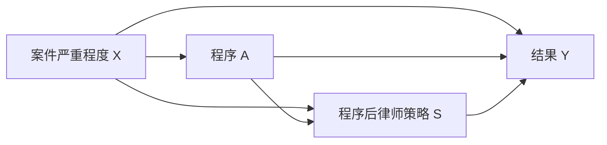

# U11.1 causal bridge and original instances: OPEN 3 -> 2

This package is bound to source `95a7cc43bfbad5c5c9ba69894c7209b9a33e730e`, changed-module run `40987962686`, job `123843315122`, attempt 1, artifact `changed-module-only-40987962686-1` (ID `12947703490`, 9,843 bytes, SHA-256 `2760b9b16a43f9e4f52b315b196f7164ac42256e68c64c55111fd14b3fac6b87`). The artifact contains the actual changed-module log and module plan. `axiom-audit.raw.txt` is a targeted extraction of actual proof output, not a substitute for the complete artifact.

The audit has 31 proof targets (8 new and 23 reused) and 21 public object checks across 11 directly bound source files. Thirty proofs report `[propext, Classical.choice, Quot.sound]`; `JurisLean.Candidates.BusinessMeasurement20261027.revocation_does_not_supply_defect_measurement` reports `[propext, Quot.sound]`. No target reports `sorryAx`. The earlier failed run is retained as diagnostic only. The general selection-weight equations below are conditional-expectation derivations stated in the original problem; the finite rational MAR Lean instance is not claimed as a general real-valued selection theorem.

## 原题 11.1：测量字典、上诉频率与依赖单位

以下均为合成例：法域记为 `J0`，固定时间基准 `t0=0`，时区为 `Asia/Taipei`，时钟换算版本为 1；`tick` 是本例合成时间单位，不冒称自然日。规则、处理、结果定义、特征及测量字典版本均为 1。目标框架为给定的 100 件一审案件，案件、阶段、行为机会、真实事件及文书记录分别标识。版本和编号用于保存对象身份；编号一致不证明记录真实、测量等值或采样独立。

测量字典限定如下。期限端点包含在窗内；缺少足以判正的有效记录，且没有完整闭窗依据支持判负时，保留缺失；未成熟窗口不能仅凭未见事件判负。

| 标签或构念 | 单位与时间窗 | 原始记录及编码 | 缺失含义 |
|---|---|---|---|
| 是否上诉 `H` | 案件；`[0,10]` | 独立登记的上诉事件为 1；完整案件框架和闭窗登记确认无上诉才为 0 | 未检索到文书不等于未上诉 |
| 是否撤销 `R` | 上诉案件的复核阶段；`[10,20]` | 按复核处置原记录编码撤销/未撤销；保留撤销理由 | 未上诉没有复核处置，不能据此编码 `D=0` |
| 程序缺陷 `D` | 案件及明示程序版本；复核窗 | 读取独立复核的 `reviewedFinding`；准确性是本题额外前提，撤销记录本身不供给该标签 | 未复核、复核依据不全或构念不匹配均未知 |
| 法官的程序动作 | 案件×阶段×合格行为机会；`[0,10]` | 核对原始动作记录的行为人、动作及实际时刻；符合声明动作记 1 | 异案、异行为人或测量总量不可得时未知；有完整闭窗依据且有效总量低于1时记0，含已确认完整的空事件表 |
| 律师提交材料的时点 | 案件×阶段×律师×提交机会；`[0,10]` | 读取外部提交时刻；在固定时钟解释下不晚于 10 为及时；完整闭窗且无及时提交才为否 | 截至本次观察时刻尚未取得可核时刻/时区，或未成熟且缺有效阳性记录时未知；晚到但已取得的记录按实际发生时刻判是否及时，不把入库晚当提交晚 |
| 期限内履行 | 案件中的具体债务关系及双方；`[0,10]` | 从实际 poststate 的支付收据读取分配额，核对关系、双方、单位、来源及现金事件；窗内累计分配额达到合成要求 10 为 1 | 已提供的支付行找不到对应收据、错关系或测量总量不可得时未知；有完整闭窗依据且有效总量不足10时记0，含已确认完整的空记录表；未闭窗且尚未达到10时未知 |

对应消费者为 `BusinessMeasurement.measureBusiness`。成功结果保留实际 poststate、字典、原始行、观察时刻和计算总量；负标签须消费完整闭窗依据。`revocation_does_not_supply_defect_measurement` 明确拒绝将撤销记录当作独立程序缺陷测量。

同一真实事件产生多份文书时，以真实事件身份去重，不能把文书条数当案件数。同案多个阶段共享案件因素并可能互相影响；同一律师的多案可能共享能力、案件选择和跨案学习。即使这些记录具有不同事件编号，也不能据此宣称 iid。本例只计算给定有限框架的数量，不对这些相关记录附加虚构的独立采样置信区间。

题设真值下：

\[
P(D=1)=10/100=10\%,\qquad
P(D=1\mid H=1)=8/20=40\%.
\]

若将所有“未撤销”一律编码为无缺陷，则得到 \(8/100=8\%\)。40% 是准确复核前提下的上诉内缺陷率；10% 依赖题设提供的全体真值；8% 是朴素编码所得比例，不能改名为总体缺陷率。

撤销率等于程序缺陷率的一组充分条件是：单位和总体相同、复核准确、撤销当且仅当该特定缺陷成立、所有该缺陷案件均进入可见复核，并完整记录处置。本题有两件缺陷案件未上诉，已经不满足这些条件。

移除全体缺陷数后，设 80 件未上诉案件中有 \(n\) 件缺陷，\(0\le n\le80\)。总体率为

\[
(8+n)/100\in[8\%,88\%].
\]

未上诉者全部无缺陷与全部有缺陷均兼容同一份上诉记录，端点分别为 8% 和 88%。分母 100 来自题设目标框架，不能从 20 份上诉记录反推。已有 `original_appeal_frequencies`、`unknown_appeal_labels_have_sharp_bounds`、`appeal_observations_cannot_identify_population_rate` 直接供给这些结论。

## 原题 11.2：完美预测与三类失败

固定 `J0,t0`，\(U\sim\mathrm{Bernoulli}(1/2)\)。两模型为

\[
M_1:A:=U,\ Y:=A,\qquad M_2:A:=U,\ Y:=U.
\]

完整观测联合分布相同：

| \(A\) | \(Y\) | \(P_{M_1}(A,Y)\) | \(P_{M_2}(A,Y)\) |
|---:|---:|---:|---:|
| 0 | 0 | 1/2 | 1/2 |
| 0 | 1 | 0 | 0 |
| 1 | 0 | 0 | 0 |
| 1 | 1 | 1/2 | 1/2 |

预测器 \(\widehat Y=A\) 的零一错误为 0。错误损失非负，因此可达的 0 就是最小错误率。

干预改变结构方程，而不是对观测事件作条件化：

| 模型 | \(E[Y\mid do(A=0)]\) | \(E[Y\mid do(A=1)]\) | ATE |
|---|---:|---:|---:|
| \(M_1\) | 0 | 1 | 1 |
| \(M_2\) | 1/2 | 1/2 | 0 |

任何只读取该观测律的程序，在两个模型中得到相同输入。更多容量、更细概率输出或校准仍是该输入的处理，不能单独使两个目标都被正确识别。任意数量的同类观测样本也具有相同的样本分布；重复已有记录更不会增加区分信息。若一个程序最终选择了某模型，它必须说明额外使用了什么机制约束或先验条件，而不能把选择说成观测律已经识别了因果效果。

三类失败须分开记录：

| 失败类型 | 含义 | 什么可以改善它 |
|---|---|---|
| 有限样本估计误差 | 在已识别目标和正确采样合同下，样本尚不足以精确估计 | 更多符合合同的独立信息及相应误差界；复制文书不算新增独立单位 |
| 模型失配 | 拟合族不能表示真实的观测关系，或变量测量有误 | 修正测量、模型族和验证设计；较低观测误差仍不证明处理交换性 |
| 结构性非识别 | 即使完整观测律已知，仍有兼容模型给出不同目标 | 能区分机制的新实验或明确识别假设；窄预测区间不能修复它 |

一个足以区分本题两模型的新增设计是：保留处理版本和结果定义，将 A 真正随机分配，使其独立于 U，并完整观察结果。在实验分布中，\(M_1\) 的两臂均值为 0、1；\(M_2\) 为 1/2、1/2。该设计在分布层面区分模型，有限样本仍须处理估计误差。仅额外记录 U 而继续令 \(A=U\)，仍缺处理重叠，不能自动解决本题。

形式证据直接复用 `Behavior.u11_1_obs_equiv_models_distinct_ATE`、`prediction_not_causal_identification`；新增原题实例只补共同 Bernoulli 权重和零预测误差，不重建反模型。

## 原题 11.3：静态识别条件、时间顺序与共同支持目标

固定 `J0,t0`。原题只限定有限 X、二值 A。四类条件分别为：

- **C_cons**：处理版本明确，实际结果与实际接受处理对应的潜在结果一致。
- **E_exch**：\(\{Y(0),Y(1)\}\perp A\mid X,J_0,t_0\)。
- **P_pos**：目标总体有质量的 X 层内，两种所比较处理均有正概率。
- **I_nointerf**：单位间无干扰，或已预先明确干扰暴露映射及其对应目标。

I_nointerf 不与处理版本一致性合并。观测拟合和来源编号不证明 E_exch。潜在结果均值存在的可积域须明示；不得无声将原题缩成有限潜在 U 或有理概率。

已有有限生成核 g 公式继续复用。命名因果桥单独负责从实际处理版本、暴露和具名条件连接到实值可积两臂均值，再得到有限 X 的条件期望公式：

\[
\tau=\sum_xP_X(x)
\left\{E[Y\mid A=1,X=x]-E[Y\mid A=0,X=x]\right\}.
\]

每一步的职责是：I_nointerf/暴露定义确定比较对象；C_cons 将实际结果接到对应潜在结果；E_exch 去除处理分配带来的条件均值差异；P_pos 保证所用条件单元在目标支持上有定义；最后按目标 X 权重平均。

最小时间图为：

总效果允许 S 随程序变化：

\[
E[Y(1,S(1))-Y(0,S(0))].
\]

固定策略 \(s\) 的受控直接效果则为

\[
E[Y(1,s)-Y(0,s)].
\]

它们是不同的干预问题。把程序后的 S 当作一般基线协变量调整，可能阻断 \(A\to S\to Y\) 的中介路径；若另有因素同时影响 S 和 Y，还可能因条件化 S 产生选择偏差。原题对 A 的条件不自动供给对 S 的第二项干预所需条件。

四个合成法律情境准确对应四类失败：

| 情境 | 被破坏的条件 |
|---|---|
| 两种动作都编码为“通知”，一种明确告知争点和听证时刻，另一种只有模糊短信 | 处理版本不唯一，破坏 C_cons 所需的明确干预定义 |
| 未记录的案件复杂程度同时影响程序选择和后续结果 | X 未阻断共同原因，E_exch 不成立 |
| 某类紧急案件必然进入 A=1 | 该层 \(P(A=0\mid X)=0\)，P_pos 不成立 |
| 律师在前案经历某程序后改变后案策略，或公开判例改变其他案件行为 | 单位结果依赖其他单位处理；简单 I_nointerf 不成立，须另定暴露及目标 |

对 L124，优先明确共同支持目标，而不新增一般限制测度框架。令

\[
C=\{x:P_X(x)>0,\ e_0(x)>0,\ e_1(x)>0\},\qquad
q=\sum_{x\in C}P_X(x).
\]

当 \(q>0\) 时定义目标总体 \(T_C=\{X\in C\}\) 及有限权重

\[
P_C(x)=\frac{1_C(x)P_X(x)}q.
\]

只报告 \(\tau_C\)，不将其改称原目标总体的 \(\tau_T\)。当 \(q=0\) 时，共同支持目标为空，\(\tau_C\) 未定义；不得利用形式语言中除零的总化值报告一个 0 效果。原目标仍不因此获得识别。

外推模型可以在新增假设下缩小不确定范围，但该缩小来自新增假设。已有同日志支持端点直接说明拟合平滑不能制造支持；原政策价值端点不直接改名为 ATE 区间。

## 原题 11.4：选择反例、恢复公式与报告限制

K1 中 A、Y 独立且各为 Bernoulli(1/2)，\(S_{\rm obs}=1\{A=Y\}\)。K2 中 A 随机、\(Y=A\)，S_obs 独立随机。完整可见律为：

| A | S_obs | 可见结果 | K1 概率 | K2 概率 |
|---:|---:|---|---:|---:|
| 0 | 0 | None | 1/4 | 1/4 |
| 0 | 1 | Some 0 | 1/4 | 1/4 |
| 1 | 0 | None | 1/4 | 1/4 |
| 1 | 1 | Some 1 | 1/4 | 1/4 |

其他报告概率均为 0。两模型都有

\[
P(Y=1\mid A=1,S_{\rm obs}=1)=1,\quad
P(Y=1\mid A=0,S_{\rm obs}=1)=0,
\]

选中样本关联为 1。K1 干预不改变 Y，两臂均值均为 1/2，ATE=0；K2 两臂均值为 0、1，ATE=1。K1 的选择碰撞点是 \(A\to S_{\rm obs}\leftarrow Y\)。只分析完整公开记录不能消除这一问题。

以下四种选择分别记录，不假定同一机制：

| 选择 | 被选中的对象 | 向前一个总体推广所缺的典型信息 |
|---|---|---|
| 进入法院 | 相关纠纷中的立案/诉讼案件 | 未进入法院的总体框架、构成、结果或可信的进入机制 |
| 文书公开 | 法院案件中的公开记录 | 未公开案件覆盖审计、公开规则及相应结果信息 |
| 上诉 | 一审案件中的上诉案件 | 未上诉案件复核数据或有依据的上诉/复核机制 |
| 数据库成功匹配 | 可获取材料中的成功检索、链接和去重记录 | 未匹配样本核验、链接遗漏机制与案件级覆盖信息 |

不同层的边际概率不能无条件相乘。若按具体顺序组合纳入概率，必须使用该顺序下真实的条件概率。数据库中的平衡或更强预测模型不能补出根本未观察到的单位框架和结果。

恢复公式分开保留以下条件。令

\[
e_a(x)=P(A=a\mid X=x),\qquad
\rho_a(x)=P(S_{\rm obs}=1\mid X=x,A=a).
\]

除明确版本和一致性外，需要：

1. 处理交换性 \(Y(a)\perp A\mid X\)；
2. 选择独立性 \(S_{\rm obs}\perp Y(a)\mid X,A\)；
3. 所用目标支持上 \(e_a(x)>0,\rho_a(x)>0\)；
4. 真实处理和纳入概率，以及目标 X 分布；
5. 所涉及期望存在。本题二值结果有界；一般实值结果只在对应可积域内陈述公式。

这些不是同一个“缺失随机”标签。以全目标单位的日志律为基准，逐步有

\[
\begin{aligned}
E[S_{\rm obs}Y\mid X,A=a]
&=E[S_{\rm obs}Y(a)\mid X,A=a] &&\text{一致性}\\
&=\rho_a(X)E[Y(a)\mid X,A=a] &&\text{选择独立性}\\
&=\rho_a(X)E[Y(a)\mid X] &&\text{处理交换性}.
\end{aligned}
\]

再对 A 条件化：

\[
E[1\{A=a\}S_{\rm obs}Y\mid X]
=e_a(X)\rho_a(X)E[Y(a)\mid X].
\]

在正支持上除以实际概率，再按目标 X 分布平均，得到

\[
V_T(a)=
E_T\!\left[
\frac{1\{A=a\}S_{\rm obs}Y}{e_a(X)\rho_a(X)}
\right].
\]

随机政策 \(\pi\) 对应联合权重
\(\pi(A\mid X)S_{\rm obs}/\{e_A(X)\rho_A(X)\}\)。

若数据库只含 S_obs=1 的记录，其期望已经归一化为选中库的条件期望。令 \(p_S=P(S_{\rm obs}=1)>0\)，则必须相应使用

\[
V_T(a)=p_S E\!\left[
\frac{1\{A=a\}Y}{e_a(X)\rho_a(X)}
\ \middle|\ S_{\rm obs}=1
\right].
\]

这要求总体选择归一化可得；不能从选中库本身无证恢复。若数据源总体与目标总体不同，还须加入目标到源 X 权重、支持重叠和条件效果迁移条件，不能只替换一个 X 边际。

在 K1 中，\(\rho_a=1/2\) 虽为正，选择独立性仍失败。仅代入正权重会恢复选中关联 1，不能把真实 ATE=0 改成 1。可见正概率与条件独立承担不同职责。

Option 报告中的 None 使加权估计贡献为零，不是在事实层面将缺失 Y 判为 0。实际报告、隐变量和估计贡献保持不同对象。

报告限制采用以下精确表述：

- 缺少总体选择与处理识别依据时，只报告“成功匹配且公开的裁判样本内关联或预测”，不称总体程序效果。
- 向进入法院案件报告效果，需要法院目标框架、样本选择恢复条件和法院总体内的处理识别条件；若使用上诉记录，还须单列上诉选择。
- 向全部相关纠纷推广，还需要未进入法院的目标框架、支持及效果迁移依据，或相应的额外代表性数据。
- 缺失单位和未复核结果属于需额外数据解决的缺口；扩大拟合容量不能凭空填补它们。

形式证据复用 `CausalSelection` 的完整可见律、异效应、选择恢复及选中库归一化定理。U12.3 的 `finiteMARRow_factorization`、`mar_visible_score_integral` 提供有限 X/A/Y、有理实际 PMF 和 Option 报告的已验实例。上述文字推导明确一般公式的条件；不将这些有限 Lean 实例写成任意实值结果的一般选样形式定理，也不为原题的“讨论公式”另建 regular conditional probability 框架。

## 原题 11.5：迁移权重、机制反例与版本对照

原题分层均值给出

\[
\Delta(0)=0.7-0.4=0.3,\qquad
\Delta(1)=0.3-0.6=-0.3.
\]

源总体 \(P_S(X=1)=0.2\)，目标总体 \(P_T(X=1)=0.8\)。在条件潜在结果均值稳定的假设下：

\[
\tau_S=0.8(0.3)+0.2(-0.3)=0.18,
\]
\[
\tau_T=0.2(0.3)+0.8(-0.3)=-0.18.
\]

权重为

\[
w(0)=0.2/0.8=1/4,\qquad w(1)=0.8/0.2=4,
\]

因而

\[
\sum_xP_S(x)w(x)\Delta_S(x)
=\sum_xP_T(x)\Delta_T(x).
\]

符号改变在这个模型中来自目标构成变化，不是测量矛盾。

三类条件分别检查：

| 条件 | 职责 | 不能由什么代替 |
|---|---|---|
| 测量等值 | X、A、Y、单位、窗口及编码在源与目标中指向同一构念 | 相同列名或版本编号 |
| 条件效果稳定 | 目标支持上源与目标的条件效果一致；原题计算暂采用更强的条件潜在均值稳定 | 源总体内的高拟合精度 |
| 跨总体支持重叠 | \(P_T(x)>0\Rightarrow P_S(x)>0\) | 源总体内的处理分配正值性 |

处理正值性用于源总体内识别处理效果；跨总体支持用于迁移，二者不混写。

撤销稳定性后，保留全部源均值和目标 X 分布，另构造目标 \(Y(0)=0,Y(1)=1\)。该目标效果为 1，而非 −0.18。它与原稳定目标在现有源数据和目标 X 构成上相同，所以稳定性不能由源拟合证明。已有 `source_and_target_mix_do_not_identify_new_effect` 直接给出这一反例。

以下版本对照表可直接检查。S0 与 T0 均使用本包合成 `J0,t0`；它们只改变总体构成。

| 项目 | 源 S0 | 目标 T0 | 若不一致时的处理 |
|---|---|---|---|
| J,t、规则与解释版本 | J0、t0、规则1、解释1 | 相同 | 先判断是否仍为同一个法律/行为问题 |
| 处理定义 | 程序版本1、具体动作说明1 | 相同 | 逐项比较通知内容、程序动作及执行方式，不能只比名称 |
| 结果定义与期限 | 结果版本1、窗口及期限解释1 | 相同 | 期限或结果构念改变时重定义目标，不直接迁移旧均值 |
| X 与单位 | 特征编码1；案件及明确阶段/机会 | 相同 | 核对分类内容、单位边界和重复记录处理 |
| 时间与测量 | 时区 Asia/Taipei、时钟版本1、字典1 | 相同 | 核对实际换算与测量流程；编号相同仍不足以证明等值 |
| 总体与选择 | \(P_S(X=1)=0.2\)，源选择机制明示 | \(P_T(X=1)=0.8\)，目标框架明示 | 使用实际总体权重，检查支持和选择差异 |
| 条件效果 | 源内干预识别结果 | 稳定性作为明示迁移假设 | 需要目标机制、验证数据或其他独立依据，不能由源拟合供给 |

若新环境 J1,t1 同时改变程序定义、履行期限或标签解释，应先判断“迁移同一干预”是否仍成立。个体法官或律师的预测准确度不自动升级为跨制度因果结论。

## 原题 11.6：五条有限证据记录与法律约束反例

B 展开保留 13 个字段：

\[
(\text{目标总体},J,t,\text{单位},X,A,Y,\text{估计量},
\text{识别条件},\text{样本选择},\text{支持范围},
\text{不确定性},\text{允许用途}).
\]

以下五条均填写合成的 J0、t0 和版本1。它们是本题有限记录，不是新的统一执行框架；识别状态来自对应推导和证据，不来自状态标签或 SourceRef 本身。

**B1——仅描述，使用原 11.1。**

- 目标总体：给定框架中的20件上诉案件；J=J0，t=t0；单位：案件。
- X：本计数不调整；A：上诉 H；Y：独立复核的程序缺陷 D，撤销 R 另列原始标签。
- 估计量：8/20；识别条件：题设准确复核，仅解释上诉内 D；样本选择：H=1；支持范围：这些上诉案件。
- 不确定性：给定有限记录的精确计数，不声称采样置信区间；全100件率仍在[8%,88%]。允许用途：描述上诉样本。
- 能说上诉内频率，不能称全体法律错误率；未上诉独立复核或有依据的选择机制会改变状态。

**B2——样本内预测，使用原 11.2。**

- 目标总体：M1/M2共同观测律下的案件；J=J0，t=t0；单位：案件。
- X：空；A：程序二值动作；Y：所定义的后续二值行为。
- 估计量：\(\widehat Y=A\)，最小观测错误0；识别条件：仅共同观测律，不加入处理交换性；样本选择：原题观测机制；支持范围：该观测支持。
- 不确定性：观测预测误差0，但兼容ATE至少有0和1。允许用途：同观测机制内预测。
- 能说完美预测，不能说唯一干预效果；独立随机处理或排除其中一机制的外部证据会改变状态。

**B3——支持范围内干预效果，使用原 11.3。**

- 目标总体：合成有限总体 \(P(X=0)=P(X=1)=1/2\)；J=J0，t=t0；单位：案件。
- X：二值；A：在各X层独立随机为0/1，各概率1/2；Y：\(Y(a)=a\)，实际 \(Y=Y(A)\)。响应只读本单位处理，暴露定义不含其他案件。
- 估计量：g公式得到 \(\tau_C=1\)；识别条件：版本1的一致性、恒定潜在结果对的处理交换性、两臂正性及声明的无干扰结构。
- 样本选择：全体目标单位，无额外选择；支持范围：两层均有两臂，C为全部X、q=1。
- 不确定性：模型内识别量精确；未提供真实抽样材料，不附经验估计区间。允许用途：该合成支持内的条件干预结论，不供给规范许可。
- 能说此明示机制的效果，不能断言真实案件满足它；真实处理机制、测量或干扰证据可确认或推翻适用性。

**B4——无法识别，使用原 11.4。**

- 目标总体：K1/K2定义的全部目标案件；J=J0，t=t0；单位：案件。
- X：空；A：二值处理；Y：仅在S_obs=1时报告，A与S_obs全可见。
- 估计量：完整可见律及选中关联1；识别条件：未获得足以排除K1/K2之一的选择条件；样本选择：各模型实际S_obs。
- 支持范围：可见A、S_obs及Option Y；不确定性：至少两个兼容干预效果0、1，不声称所有兼容目标只这两个值。允许用途：可见律、选中样本事实及非识别报告。
- 不能报告唯一总体效果；未选中单位结果、有效选择机制或干预证据可改变状态。

**B5——依赖显式迁移假设的目标效果，使用原 11.5。**

- 目标总体：\(P_T(X=1)=0.8\) 的T0；J=J0，t=t0；单位：案件。
- X：二值；A：原题二值干预；Y：版本1的同定义结果。
- 估计量：源效果0.18，目标效果−0.18，权重1/4及4；识别条件：源内干预识别、目标到源支持及条件潜在均值稳定。
- 样本选择：源框架及机制明示，目标X框架已知；支持范围：目标两层均由源支持。
- 不确定性：−0.18是明示迁移假设下的量；撤销稳定性后已有兼容目标效果1。允许用途：条件迁移结论。
- 不能说源拟合已经证明目标效果；目标结果数据、内容级测量核验或独立机制证据可改变状态。

最后检验“履行率上升，所以合法且应采用”。取相同完整行为模型 M1 和相同外生律：两环境中，程序0的行为率为0、程序1为1，改善为1。外生规范环境分别定义为

\[
E_+:\Pi_{\rm adm}=\{0,1\},\qquad
E_-:\Pi_{\rm adm}=\{0\}.
\]

可将它们记为同一J0,t0下的两个合成规范版本，行为版本保持1。行为模型完全相同，因而完整行为分布相同；但程序1只在E+的外生许可集合中。行为数据不能区分这两种规范约束，故不能独自推出“合法且应采用”。该结论直接复用M1的正效果，不把预测正确率最大化定义成许可集合；即使合法，是否应采用仍需另外的规范目标和权衡。

## 共享原题 04.4：两个缺失端点与一个充分识别条件

本有限见证明确取S=T=1，只由M控制结果可见，避免把样本纳入和结果缺失混成同一机制。两个实际有限概率表为：

| M | Y | 缺失全失败模型 | 缺失全成功模型 |
|---:|---:|---:|---:|
| 0 | 0 | 1/2 | 0 |
| 0 | 1 | 0 | 1/2 |
| 1 | 0 | 1/4 | 1/4 |
| 1 | 1 | 1/4 | 1/4 |

两表非负且总和为1。可见报告保留M，将M=0的Y替换为None；于是两模型都有None质量1/2、Some 0质量1/4、Some 1质量1/4，全部可见数据相同。

两者均满足

\[
P(M=1)=1/2,\qquad P(Y=1\mid M=1)=1/2,
\]

总体成功率却分别为1/4、3/4。原文允许交付两个可行端点，因此不必为该题另建连续尖锐集合框架。任何仅依可见律、且对两个可行模型均可靠的区间都不能收成单点；新增实例直接消费已有观察歧义定理。

选择的额外充分条件为外部机制提供的 \(M\perp Y\)。在本例S=T=1且记录率为正时，

\[
P(Y=1,M=1)=P(M=1)P(Y=1),
\]

所以

\[
P(Y=1)
=\frac{P(Y=1,M=1)}{P(M=1)}
=P(Y=1\mid M=1)=1/2.
\]

独立关系来自额外机制条件；记录率和可见成功概率来自相应记录；目标框架及权重来自本例S=T=1的明示设定。它们不由一个“随机数据”标签共同供给。若S未知且非平凡，不能沿用此式无证推广到T，仍须处理样本纳入机制和目标权重。

机制未知时，记录率、可见成功率及可见报告律仍可识别；完整总体成功率不能从中唯一恢复。本文没有把任务笼统归为“没有数据”，也没有将缺失Y记成真实的0。

## 共享原题 06.6：行动价值接口及明确保留范围

本包只履行L131的因果评估接口。实际行动价值必须来自：

1. 已验证、适用于当前处理版本和目标总体的转移/干预模型；或
2. 明示一致性、交换性、正性及所需选择条件的政策价值识别结果。

输入保留实际结果定义、目标总体、处理版本、选择/支持条件和误差前提。观测关联、训练高分或目录中的来源引用不能直接充当实施后的收益模型。接口缺失时，保留条件 \(J_j(\pi)\) 未解，不把相关性score代入收益或风险约束。

L129和L133中的风险约束算例、增加约束排除原最优策略、空可行集报告及其最低评估接口仍需相应证据。不能把“选择最不坏者”报告为已经满足风险约束。本包不重建完整因果或离线策略理论，也不以本段代替这些风险义务。

## 原题条款覆盖

以下为原题条款覆盖，不把共享条款映射本身当作阻塞，也不据此改写其它原题的未完成义务。

| 原题段 | 状态 | 本轮覆盖依据或保留义务 |
|---|---|---|
| 11.1 L93–99 | COVERED | 既有上诉频率、兼容范围、实际测量输出和撤销/缺陷分离，加本字典、闭窗/晚到记录边界及依赖说明 |
| 11.2 L103–115 | COVERED | 既有反模型和非识别结果，加原题Bernoulli/零错误实例、最小错误率说明、新实验设计及三类失败区分 |
| 11.3 L119–126 | COVERED | 命名条件三桥、旧有限g公式、时间图、四失效故事及明示共同支持目标；不缩成有限U/有理概率，也不扩动态干预 |
| 11.4 L130–140 | COVERED | 完整K1/K2、选择恢复和归一化、有限MAR实例，加条件期望推导及四机制报告限制；不宣称任意实值选择Lean定理 |
| 11.5 L144–154 | COVERED | 原例、迁移定理、机制改变反例，加版本对照及三条件分开 |
| 11.6 L158–162 | COVERED | 13字段、五语义状态、五条已填记录及同行为/异规范约束实例；未新增一般执行或证书框架 |
| 04.4 L113/L115/L117 | COVERED | 实际有限概率表、两个可行端点、同可见律非识别、MCAR恢复，以及来源和可识别量说明 |
| 06.6 L127–134 | PARTIAL | L131因果行动价值接口已覆盖；L129/L133的风险算例、约束排除和空可行集处理保留，不由本包填掉 |
