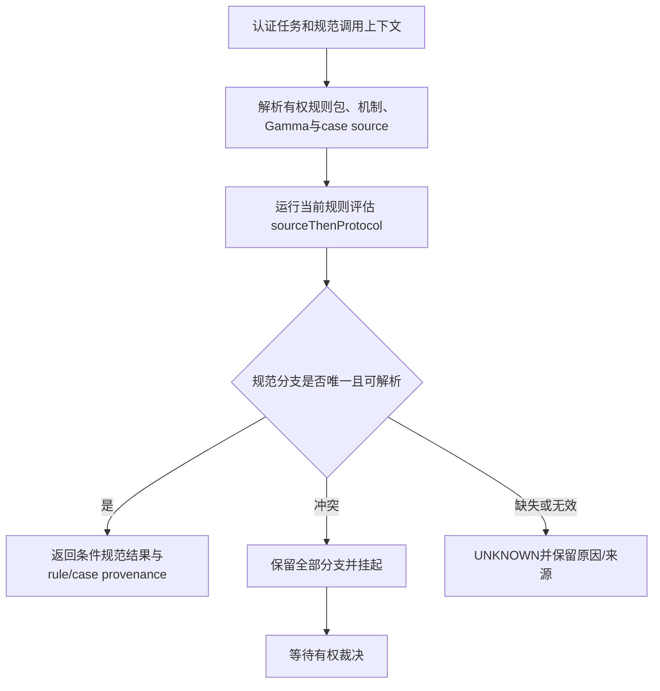
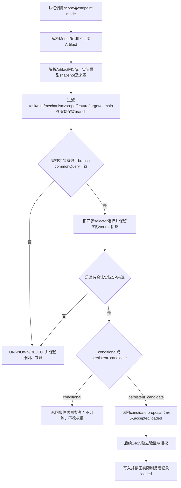

# U00 十五条实际消费边复核

2026-10-27（Asia/Taipei）。范围：v003 原 `04_全阶段接口与连续消费.md` 的十五条边，对照当前冻结 `Final20261021/Pipeline.lean` 的实际调用及 PR30 新增拟合消费函数。这是源码核对，不是新 Lean 验收，不改冻结源码、债账或 pin。

核对基线为已合并 main `bb893ccf7bcda23da0c0b64f755c505558e115f1`。PR30 新函数按 `c6505137168377be821fbcc65dbb8842bd0eed33` 检查，其模块 run `40388553512` / job 121803172754 成功；整条验收另行记录。本表的“已接核心”只指下列具体参数流，不能解释成整条原合同已验收。

| 原04边 | 实际源码及参数流 | 当前结论及必须补足的义务 |
|---|---|---|
| 1 来源→表示07 | `Pipeline.run` 调用两次 `Representation.proposed_common_model i.view ...`；`SourceView` 的对象映射、同案字段及支付载荷被检查。 | 部分接通。来源身份、提取观察与解释的真实性仍是具名前提，不能从对象编号相同推出。 |
| 2 表示→编译03 | `run` 同时检查 `i.facts` 与 `i.supportTable`，把所得事实传给 `runBound`；两个支付载荷另作参数传入。 | 部分接通。编译事实并非从前述表示输出提取；同案共同对象与支持表之间还须有实际绑定和一般证明。 |
| 3 编译→时间/证据08 | `runClosed` 的 `derived` 只用于检查 `permissionAtom`；规范历史、证据项及程序输入仍取自 `i`。 | 未完成原边。新来源 DAG 检查器已能向有限闭包传递真实叶子，但旧 U00 未调用它，也未把其出处/时间/观察需求交给时间及证据消费者。 |
| 4 拟合01→概率04/校准05 | 旧 `runClosed` 比较 `fitExpected/fitSupplied`，并取外部校准记录；新 `fitThenCalibrationGate` 则实际拟合样本、选择预测表，再传入 `consumeCalibration`。 | 新独立边已模块验证，旧 U00 未接入。实际置信事件、标签桥与联合抽样条件仍须精确证明或列为外部前提。 |
| 5 规范/证据→Harness02 | `derived` 控制候选动作，Harness 检查外部提供的两个世界动作表；规范 env 后续另验，`judgmentProcess` 没有成为允许动作的输入。 | 部分接通。需从同 Γ 下实际规范/证据结果产生允许域，并证明世界非空、反映及实际后继合同；授权门仍必须独立保留。 本次条件性实际执行后态、完整付款列表与原gate精化由独立模块证据验证（source `1bd8db47b728249fe240312fc5e570ce7290b62a` / run `40791067212` / job `123176137083`）；只为边5补充证明，原规范/证据产生允许域等既有producer义务保留，旧Pipeline接线不变，状态不因此升级。 |
| 6 概率04/05→决策06 | `prediction` 的 Known 仅决定是否调用选择器；数值计算直接读取 `i.alternatives` 内的 `OutcomeValue.probability`。 | 未完成数值消费。须让对应目标/窗的实际预测值或区间进入同一决策计算，保留干预桥、单位及联合预算；不能用另传的概率替代。本轮 U04.2 独立数学证据（source `5c8cf787c1d545a0ab1e037fa793d8f6417b886e` / run `40879691794` / job `123467594841`）补充证明三事件概率区间、污染与条件界；旧 Pipeline 仍读取 `i.alternatives`，本证据未把新概率结果接入旧决策消费者，边6状态不变。 |
| 7 决策→事务02 | `runClosed` 检查选中 IR 的 `execution = [p1,p2]`，随后用这两个相同载荷构造请求和独立授权检查。 | 已接载荷核心。仍按原合同核同案、关系、单位、业务键、预态与效用/风险计算共同输入的一般组合证明。 |
| 8 事务→账本09 | `executePayments` 把第一笔实际 `.committed` 后态传给第二笔；`finishPayment` 使用实际 outcome 的 post。 | 已接后态核心。既有后态不变量和 10/7/7 用例不得替代所有原题子结论、零额/返还/未知提交等一般义务。 |
| 9 账本→授权/轨迹10 | 有 refresh 时，先把 `actualPost1` 传入 `refresh`，再把返回的新句柄及其 Γ 传给第二笔授权与执行。 | 已接刷新核心。继续核原合同全部上下文字段、历史、实际 env 与失败分支，不从授权标识推定现实授权真实。U10.1独立包新增实际 `actualPost.env`→`selectedHorn/fullHorn` 求值及非空内部refresh后、继续执行前完整Γ/history/permission/process复核的模块证据（`U10_1RefreshRuleProtocol20261030`，subject `bf95766f1e68a82b2bda80db8712b39611233482`，run `41018909983` / job `123941482566`）；它未修改旧 `Pipeline.executePayments`，不表示旧消费者的完整规范、真实授权或失败分支合同已全部接通。 |
| 10 业务日志→测量11 | 支付已知后态仅用于比对 `i.observation.mechanismVersion`；测量日志本身仍是独立外部输入。 | 部分接通。须由实际业务事件/回执和观察材料构造同关系、同测量单位日志，并保持观察窗/缺失机制；同机制版本不等于同事件。 |
| 11 测量→政策12 | 实际 `observation` 的 Bool 通过 `Behavior.indicator` 写入 `PolicyRequest.outcome`，再执行政策值计算。 | 已有结果值消费，但合同仍不完整。案件、目标/响应版本、处理、日志政策、支持与识别证据还需同源绑定；来源引用存在不证明可交换性。 |
| 12 政策/经验→RSI13 | `policyValue` 的数值没有参与候选更新，只用 Known 状态作为开关；`addLabel` 返回的实际标签库也没有传给 RSI 状态或拟合。 | 未完成实际反馈消费。须在相应写域内使用实际输出，并保持规则/机制/个人等五类写域和独立权限。 |
| 13 RSI→候选更新14 | RSI 服务读取旧 checkpoint；候选与第二候选来自独立 `Input` 字段。 | 未完成候选生成/承接。须让实际 RSI 后态及其版本、资料和作用域进入候选更新，不以候选名字或同版本号代替内容绑定。 |
| 14 更新→迭代15 | `Iteration.twoRounds` 将第一次 `Feedback.consider` 的第二分量传给第二次 `consider`。独立 `Feedback.loadAccepted` 存在，但此调用链没有调用它。 | 只接通统计接纳后的值传递。必须补齐候选、统计合格、授权与实际 Loaded 的分态，并让下一轮读实际 Loaded 或拒绝后原状态。不能把 `Assessed` 直接当已加载。 |
| 15 迭代→下一次拟合 | `Pipeline.Output.modelAfterRounds` 返回 `Assessed`；本入口没有用它发起下一次实际拟合。 | 未接闭环。须明确下一轮实际参数/数据/版本来源，证明拒绝保持、预算累积和变更目标后证书失效；不能把另一个手填旧模型当实际后态。 |

源码定位：`Pipeline.lean` 的 `Input` 第151行、`runClosed` 第202行、预测/决策第209–225行、事务后测量及反馈第239–255行；`Iteration.lean` 的 `twoRounds`；`Feedback.lean` 的 `consider`、`loadAccepted`、`addLabel`。行号仅用于此次检出，函数名与受测提交才是引用边界。

现有 Python `tools/unified_math_v2/unified/win_model.py` 已有真实的 `validate_splits → fit → calibrate → evaluate` 调用，使用有限超先验贝叶斯模型及独立校准/测试分区；因此不能说“仓内没有拟合实现”。它与本轮有限类 ERM 的函数、任务合同及证明不是同一对象，尚不能据此声称两者精化关系或完整 U00 已证明。

后续施工以本表列出的实际参数缺口为对象，复用既有已证模块；在独立入口补齐必要连接和组合定理，保留冻结 `Final20261021`。将结果值改为 Known、增加 import 或把 metadata 改为相等均不构成接通。全部15条边仍纳入总目标，不能用已接核心的数量抵销未接部分。

后续进展：PR32已全绿合并至`57425c416c5053cdc7c7182a5382884ba916c3d5`，合后Authority `40404187854`全链成功。第四条边新增`SampleCalibrationConsumer20261027.runSamples`，实际调用拟合器、以实际拟合结果及校准样本计算证书，再读取该模型的查询分数；按真实EventId检查分区，按整个预定模型×阈值族证明选择风险，并由执行中的有理数检查推出置信半径条件。subject `3ec7fe89cbafd09410f68400e923db3bc0dd208c`的独立run `40407520488` / job 121869022779通过10个精确目标与8个执行检查；整条分支验收另行进行。该函数尚未替换旧U00调用，分数仍不是个体事件概率，不能据此把第六条及其他未接边改为完成。

最新独立接线进展：`ProbabilityIntervalConsumer20261027.runProbability`实际调用拟合器，由实际预测表的查询分数选取等分数箱，再以实际校准样本生成经验概率和置信区间；整个预定模型×查询分箱族统一支付置信预算。`IntervalDecisionConsumer20261027.fitToDecision`实际读取该输出，使用其概率及区间计算精确金额、效用和风险；没有另传一组概率。组合定理把同一个可测联合置信事件传到实际返回的决策计算，显式保留分箱观察律的含义。独立subject `098224d9cd7a1f7f956b49745ea162bc866ff9be` / [run 40418104346](https://github.com/laubeing-droid/legal-math-modeling/actions/runs/40418104346) / [job 121905397514](https://github.com/laubeing-droid/legal-math-modeling/actions/runs/40418104346/job/121905397514)通过概率9个目标、决策10个目标，以及8+10个实际求值。原始输出和源码摘要分别存于两份`docs/formal-release/evidence/*interval*-consumer-20261027/`证据包。

该进展补了第4/6条边的独立可执行函数及条件证明，尚未替换旧U00的调用。分箱概率不是点态正确性，也没有自动变成干预结果分布；同案来源到查询、实际因果桥、共同偏好与完整合法候选集仍须在总入口绑定。`chooseMaximin`是明确选择的偏好规则，匹配Γ、效用版本和请求风险上限，并保留合法集合与区间风险约束；无合格候选返回none。不能把这19个具名目标当作19条原题或已关债行；最终提交的ULM/Authority全链另行验收。

当前 OPEN=20、closes_debt=false、不翻 discharges、不改 subject21862d9b / Authority40274167574 / named61 的冻结 pin。原题的数学证明、实际消费、现实/法律前提和产品部署仍分别验收。

PR35最终集成已完成：最终head b10bd928c1ad70d2d1c9f04fd1de5e8bde14aaef的ULM40419406707/Authority40419407371全部适用门通过，final121915386453实际PASS，官方证书及独立验证器核对成功。授权合并0bb7d983338a0be054a012618c5b30cce9692eab，与受测树135f1f09dbcf69f68438f2b05875711bffd40af3完全一致。main新run40421287028全部适用门成功，final121921719203实际PASS。连续付款/刷新消费者已进入独立模块CI40421517173；尚未据此更新第7—9条为新实现已通过或总入口完成。

第6—9条新增消费者已有独立权威证据：DecisionTrajectoryConsumer20261027.runSampledDecision实际调用样本拟合/分箱概率/区间决策/显式maximin，再以精确选中付款序列进入任意有限付款与授权刷新解释器。提交后实际句柄进入尾调用，授权读取当前Γ和完整载荷，重放保当前态，UnknownCommit停止。一般证明从实际执行结果构造Trace.Path，保持数量/现金/环境/回执不变量及用键单调性。subject a925438a2a0b9cbf602d0661e2262dbb03a3f27d/run40422688565/job121920717399：12目标、13求值成功，仅标准公理。接根后108项相关Python测试通过；PR36 final4969a925359b04c3c340342c84da3f41d908e985正在ULM40423804865/Authority40423805327全链验收，尚未合并。此为付款/刷新片段；旧U00和其余边、所有混合操作与外部因果解释仍未因此完成。

下一段已核实的身份缺口：Final20261021.Feedback.Label以MeasurementId的unit和target作为addLabel去重键，旧Pipeline传入observation.unit；原题14.2要求按事件身份幂等，Behavior.MeasurementLog已有独立EventId字段event。测量身份不能直接当业务事件身份。补足真实反馈消费时须保留事件/测量/记录区别、同事件重放/冲突/迟到更正，并让实际有效标签集进入拟合，而不是直接复用旧unit键并改标签名称。

PR36合并复核：最终head4969a925的ULM40423804865和Authority40423805327全部适用门成功，final121929865574实际PASS。官方证书12698214102及独立验证器无错误；test merge8848b3fd与最终head同树。已授权squash为37460d99，fetch main后同树/空diff、归档门通过。新main Authority40426010285运行中。新增有限付款/刷新解释器实际连接边6—9的上述片段；旧总入口和其他边仍按原合同继续。

事件反馈新增片段：EventFeedbackConsumer20261027在subject283c5521db265c4a9815805c3f49f37677f91b6c的独立run40426485868/job121933418793成功，通过15个精确目标与18个实际执行断言。实际外部确认观测→EventId去重/冲突/更正/撤销→实际后态训练视图→有限经验拟合已连接；不再拿MeasurementId作样本键。原始历史与当前训练视图同时保留，注册确认及权限仍有外部解释前提。该片段尚不是政策数值→RSI实际更新、实际Loaded→下一轮或整个U00；完整PR验收尚在准备。

后续验收更新：PR36合后main run40426010285全部适用门已成功，final121936645983实际PASS。事件反馈PR37最终head6ae488b6、tree401c917c，110项相关Python及12项inventory测试已通过；完整ULM40427569499/Authority40427569980运行中。固定目标标签语义保持和指定两点实际拟合反例另在A分支施工，当前仍CI_PENDING，不提前列为证明完成。

PR37完成合前全绿及授权合并：ULM40427569499/Authority40427569980全部适用门成功，final121941692315实际PASS；证书12700459186、独立验证器无错误。test merge f27c0c8a同受测树401c917c，授权squash90946955后同树/空diff及归档门通过。新main40429123235运行中。进一步源码复核：Feedback.consider仅比较包含protectedDomains的Scope相等和单一上下界，没有逐保护域风险计算；Iteration.twoRounds不调用Loaded。这仍是后续实际验证和加载消费义务。

固定目标语义模块13目标已通过独立run40429431857/job121943232612，subject1ed7eae9；实际processAndFit返回候选的样本语义已组合，错误旧标签修复不要求旧标签正确。PR38最终head60dd0c0e/tree7de7a4e5，112项相关Python通过；ULM40430452947/Authority40430453424运行中。该证明不提供保护域统计界、授权加载或原U00总入口接线。

PR37合后main40429123235现已全部适用门成功，final121947193110原始日志实际PASS。PR38最终head60dd0c0e的12项inventory测试也已通过（91.45秒），连同112项相关测试（84.80秒）均已保存collection/JUnit；完整ULM40430452947/Authority40430453424仍运行中。

PR38合前ULM40430452947和Authority40430453424全部适用门成功，final121951259623实际PASS；证书12702576416及独立验证器无错误。test merge f3d23574与head60dd0c0e同树7de7a4e5，expected-head squash784113f4后同树/空diff及归档门通过；新main40432100560运行中。下一批依原13/S14对实际验证样本逐保护域计算旧新损失，固定全部候选含父模型，联合支付各域失败预算，再连接实际授权加载和下一轮。

2026-10-27: PR38合后新main Authority40432100560全部适用门SUCCESS，Python121951998394、Lean121951998194、runtime121951998454、mathematics121956793403、sevenaxis121956793413、certificate121956861621、final121956944902实际PASS；原始final日志已保存。B protected-feedback数学源在8a9330ba/run40433882641通过编译，审计驱动因两处多行record语法失败；修复后fece078f7ae6defe0c6e7cd55e021867efb89ae7/run40434490740待验，12目标17执行，未接根。数值门已明确命名passesBounds，不混作外部抽样前提或授权加载。A新validated-feedback-load分支从fece078f起，subject5ea01c4fa978adb9b5562e8b5c99c27559cfdb06/run40434501868待验，9目标15执行：完全匹配旧loaded/当前journal、重算完整evaluation、预声明采样catalog及完整独立许可后实际写入并回读；拒绝仍保留模型并追加历史；下一fit实读加载模型放入搜索类。数学仓纯model-store实现，非生产数据库/JC/Harness部署。

2026-10-27新片段证据：ProtectedFeedback12目标/17执行在fece078f/run40434490740/job121959790710成功，actual evaluate从各域实际样本算风险并联预算；ValidatedFeedbackLoad9目标/15执行在1314be95/run40435047031/job121961611215成功。后者实际prepareNext读当前loaded.table入搜索类，以actual processAndFit后态生成候选；activate重算evaluation及精确前态/采样catalog/许可，writeAndRead写入后自行回读；后续prepareNext读取新loaded，没有并列旧checkpoint输入。第14/15边有新执行片段及一般证明，但旧Final20261021.Pipeline/Iteration仍未切到此新片段，business measurement/政策值/RSI与U00整链未由这些独立结果自动完成。PR39最终双链运行中；加载批次完整PR准备中。

最新验收：PR39保护域验证最终双链与main新run40440496556均全PASS；PR40实际模型槽位写入/回读→下一真实fit在d4fabd72双链40440775188/40440775558全PASS并合main03de4f36同树，合后新main40442390294待验。PR41条件历史新块预算独立12目标6执行PASS，最终祖先更新到2ebab253且源码树a8656615不变，新双链40442511126/40442511600待验。CurrentContextRollback在e579de93/run40442236021独立9目标8执行PASS，实际以当前journal重算旧weights的评分和验证、独立许可后重新加载，保持当前N/训练/历史；完整PR待验。以上没有把旧Pipeline/Iteration自动接通，business测量/政策数值/RSI与完整U00仍需实际传递输出和后态。

PR40合后main40442390294全部适用门SUCCESS，final121989516039实际PASS原日志已保存。PR41最终2ebab253/treea8656615双链40442511126/40442511600全PASS，官方artifact12707032952/digest310343f65d0c9c726b188aaf21156c236658c35a2680069d50efcb4ec48c32f8、verifiererrors[]，testmerge0edfdcc3同树。expected-head合并3781a5b521aab43a04147af998e0268ac2adee6a，已fetch同树、实际main archivegatePASS；新main40444019650待验。
Rollback根集成content4f8f6260c49f951aaaab206bda0b67df1b8c0953/inventory07dff81673412c8c952f4799a17500843e2678cc；140相关测试156.66s、12清单93.18s PASS。合main祖先不改源码树，最终858fcd4166df67dfcf2a4ffebb1cb979eb0fb693/treeedf5d4ca52dbd17f316031b442915ef86c1f68e1，已推送并创建附加PR42，base main，完整双链待验。
下一原义务是E15实际轮账/新块防重用/当前可信根/学习器变更。已读原题15及E15和FrozenRSI；FrozenRSI现有五写域与参数不干扰定理可复用，但不能冒充已实现带当前权限的机制变更。

PR42最终858fcd41/treeedf5d4ca全双链40444148103/40444148632成功；actualfinal121995239946 PASS，证书12707683498/ae06899a8f969e0031003ad860852fc3c4f00dec582d0647252137f50aa2eef7、verifiererrors[]，testmerge88863988同树。合main7c56e946e0207a46b2a5fde68f48f7f25ee20b75同树空diff、actualmain archivegatePASS，新main40445480104待验。
B AdaptiveRoundLedger首稿5fcce8f5/run40445170629/job121994609117 FAILED：两处record布局、split多目标不支持及match化简证明写法，未接根。修复d3c301d94ce82dcf6c10918b11759330040b8832/run40445643984/job121996164998待验，15目标17执行。继续原E15复核发现须在轮状态保存固定protectedDomains并阻止调用方删保护域；本地已补该字段/guard及三条实际负例，尚未提交，预计20执行。源码外部iid/来源/授权前提未改变。

PR42合后main40445480104全部适用门SUCCESS，final121999373940实际PASS原日志留存；PR39至42各批最终双链、同树合并及实际main新run全部完成。B当前5da99fc8cee319bdfb55d46cdcda2cd48df3a293，已合main42祖先195ddc38但新模块未接根；独立40446553400/job121999119450待验。15目标20执行；d3c301d9核心编译成功但驱动两处record语法失败，2cce859d增加固定保护域后两处proof达到200000heartbeats；5da99fc8通过先剪枝再分结果消除重复展开，没有放宽上限或检查。下一实质复核已读S11/S12/E11/E12：现有Behavior只有M1/M2及数值迁移等，未定位选择恢复一般公式、K1/K2完整可见律或实际业务事件→测量→政策/反馈消费；应复用原IPW有限核并保留条件识别前提，不能从观测拟合推出因果或法义。

PR43轮账最终head5774fdfe5ee2a0061a8f242bbf31c31de5c881d7/tree1a41a5a944467a4b84e60a07c3f6af6a2f7f2fdf：142相关测试156.26s及12清单93.26s PASS；独立5da99fc8/run40446553400/job121999119450，15精确目标20执行PASS；根集成ULM40447865003/Authority40447865403全部适用门SUCCESS，actual final122006839770 PASS。官方artifact12709417375 SHA256 6b0472ad33c0f4607114aa5c72cc36c27c58b56dcd13ad546267fc0d8fa93805，verifiererror_codes=[]，证书/testmergeafef83a3同接受树。已expected-head squash为ed326eaf36d9344b17c7ebc98f4fb744f7beac03，fetch同树/空diff及actual main archivegatePASS。新main Authority40449236177运行中，尚不标PASS。
当前A causal-selection分支dc8c9b159edfa64af7ad80ea6e57522311268526，独立40449209254/job122007689620运行中，12目标7执行；首稿229c7939/run40448280445/job122004671024失败在冗余simp_rw和有限和decide化简，未列PASS。新版增加实际观测joint的g公式及潜在结果均值构造的迁移反例。未接根。B已保留PR43分支；下一对照专题12实际政策评价/截断/支持区间与响应模型。整个U00共同实验、全部原题子结论与15条消费边继续，OPEN20、closes_debt=false、CAND8八条和冻结tip_pin/discharges不变。

PR43合后main40449236177所有适用门SUCCESS，actualfinal122012756789 PASS，原日志已存；PR39–43最终PR、同树合并和实际main新run均完成。PR44 causal-selection已附加：head542946b9d77787218a9b97f87f0a47eed5cf3730/tree80a4d646c7f628229640261ec7762fe82c43683a，独立dc8c9b15/run40449209254/job122007689620为12目标7执行PASS；144相关155.92s、12清单96.83s，content5b4a6072及bound LF库存542946b9；完整ULM40450390460/Authority40450390836运行中。
B policy-evaluation已合PR44原分支祖先7721dcc2，独立b25b14dd/run40450127416/job122010649641，16目标8执行PASS；原8f497e0d/run40449847943/job122009753570失败两处证明化简，不作PASS。接根146相关188.31s PASS，概念/527模块同名/441文件禁止项PASS，全regen纸面CLOSED_NO_BINDERS1710，content6b00168已提交，bound LF inventory及12测试进行中，尚无PR45。A已保存PR44分支并切新formal/policy-response-20261027，自main43起，ff43e3c7f33ba32535d8f7f74a3db3670983feae/run40451010939待验；17目标7执行，包含logit原softmax等价、真实质量/评分极限、全初值阻尼充要条件、非中心振荡和规范信息边界，未接根。整个U00、业务测量/政策/RSI实际消费及原题未对齐项仍继续，不借批次通过宣称全目标完成。

2026-10-27续核：PR44最终head542946b9d77787218a9b97f87f0a47eed5cf3730/tree80a4d646c7f628229640261ec7762fe82c43683a，ULM40450390460/Authority40450390836全部适用门SUCCESS，actual final122016006899 PASS。官方artifact12710713004 SHA2563383bef872d116bc8571bc712176f60245548dc53c5904f677ba816a01a0d583，独立verifier无错误；testmerge6ec92d330与expected-head squash d9397d83f547c8e422ac3ff6fe95e675b01ca77d同接受树、diff为空，actual main archivegate PASS。新main40451949743运行中。
PolicyEvaluation在已通过b25b14dd基础上发现任意数据选择值需显式可测性，已加强结论为可测事件且概率下界；0cddf2c120de92f93c64eb7c4d0066d7934f74d7/run40451570271/job122015257624独立16目标8执行PASS，原始265行32块及源码已重新绑定。最新146相关测试155.86s PASS；概念/527模块冲突/441文件禁止项PASS，content d60edd17后LF绑定inventory96716fdb，12清单待验。main44祖先合入前已核原因果源码祖先及树等价，55b0dda9不改源码树。
PolicyResponse c77fd50a8e6c0b937b0315ea1a6647387d7ba561/run40451401604/job122014729609独立17目标7执行PASS，raw117行34块、标准公理和两个源码绑定均留存；首稿ff43e3c7/run40451010939失败保留。原logitsoftmax等价、真实质量趋0而评分趋1、任意实初值收缩与反射振荡、原固定点半径及全[0,1]初值阻尼充要条件均具名。A已提交独立证据d739f1ad并合入B最新政策源，正在接根与生成，不宣称完整PR完成。原业务→三类测量字典→有限允许政策→分区RSI及U00仍需实际调用，不能从这些模块全绿自动推出。OPEN20、closes_debt=false、CAND8八条、冻结pin和discharges未变。

2026-10-27续核：PR44合后main40451949743全链SUCCESS，actual final122020882929 PASS原始日志留存。PR45最终96716fdb825ed695584797f5876754a16ed70ea1/tree36556762021bafac1d3a57c327a8121985d39865，146相关155.86s/12清单96.10s PASS，ULM40452852790/Authority40452853574全链SUCCESS，final122024437356实际PASS。官方artifact12712206408摘要5bcacd89a5d3f3a3abdfd896f8bcec22abd56c13d6e514884cf01b4176e4128f，certificate/verifier及error_codes=[]均核对；testmergebc49eac030同树，expected-head squash d743c9d1101e2eec654f685170961d0942f9fd33同树空diff，actual main archivegate PASS。新main40454600172运行中。
PR46策略响应已创建并附加：final7671f8c0036e38a07c8f269bc737d172e653fd0c/tree097346ec5f9df3bb4a0e5f96f51320e3591a9590；17目标7执行独立c77fd50a/run40451401604/job122014729609 PASS；148相关164.15s/12清单100.98s PASS，概念/530模块冲突/443文件守卫PASS。content e895a49e后LF清单22417673，再核PR45源码祖先及与新main内容相同，7671f8c0只加已接受main祖先、树不变。ULM40454686348/Authority40454686647运行中，未合并。
BusinessMeasurement已独立PASS：subject6923d4bbb07d305ab9087bd49fea3680d461e8a4/run40453954728/job122022821909，14目标18执行，203行28原始块，标准公理choice11/Quot14/propext14，源码绑定已存business-measurement-20261027。首稿9913206b/run40453513600/job122021434343失败为分支消去/布尔拆解，未算PASS。原业务轨迹实际后态进入测量；三类字典、完整窗口负标签、回执抵充而非现金、重复事件/未知提交/撤销非缺陷，以及100案锐界和不识别都有相应声明/执行。B已合入PR46源祖先后接根，150相关175.12s PASS；全regen+paper重绑定后CLOSED_NO_BINDERS1713，正在静态检查/内容及绑定清单，不宣称完整PR通过。
A目前formal/measured-policy-20261027，subject5baf46b19b615f701b53ddd69ba63ee94d6d9726，run40455108881/job122026510160待验，11目标16执行。实际测量→预处理特征/处理绑定→有限支持/权重/半径检查→独立允许集内数值建议；共同iid可测置信事件到实际selector的非降级界；实际外部标签→事件账→旧Loaded与实际journal生成下一候选。未接根，不能提前标证明或U00全链完成。policy数值用于建议，经验用于数据写域，不擅自把政策值解释成模型权重。
仍按原97主问/266段/105工程要求/15消费边复核来源表示→编译→时间证据→Harness等未接部分及U00共同见证和联合实验；新模块通过不抵销其余义务。OPEN20、closes_debt=false、CAND8八条、冻结pin及discharges均保持。

PR45合后main40454600172全部适用门SUCCESS，actual final122028505420 PASS原日志已保存。
PR46最终7671f8c0036e38a07c8f269bc737d172e653fd0c/tree097346ec5f9df3bb4a0e5f96f51320e3591a9590，ULM40454686348/Authority40454686647全部适用门SUCCESS，actual final122029987160 PASS。官方artifact12712590531摘要d6bd84ad55eeb2651d070b0a7c5085c7b095ce5e15974b415e3c4a7499ce65d9，证书/独立验证器无错；testmergec1fd49af同树，expected-head squash0eb7a4ab6fa6012f922f7749d9414f0d906bec3f同树空diff，actualmain归档门PASS；新main40456323702待验。
PR47已创建附加：BusinessMeasurement14目标18执行独立6923d4bb/run40453954728/job122022821909 PASS，150相关175.12s和12清单97.48s PASS，静态概念/531模块冲突/445文件守卫PASS。content776a37b0f1d7、LF绑定inventorye6dc5f7923275b7021bf06f3d7e2822c377b1cdc后合已接受PR46main祖先，源码树不变；最终972545596ff591386dc7c390f73e603f786f2665/tree159852b92a0b0e1835849b30cf15651c60eab530。完整PR待验。
MeasuredPolicy首稿5baf46b1/run40455108881/job122026510160失败为类型推断和区间转换；1ac981d6/run40455985594/job122029302361失败为单点域预算函数化简后类型转换，均未算PASS。当前14694468b39d50b216bff1ac393f6bdcbe30f1e3/run40456458270待验，原11目标16执行及命题条件不变，未接根。
来源/表示到编译实际连接与原03/07/08全部段落继续；已有部分表示、DAG和时间/程序定理已读，不以待映射等同无实现。U00及共同实验未完成，OPEN20、closes_debt=false、CAND8八条、冻结pin/discharges不变。

PR46合后main40456323702全部适用门SUCCESS，actual final122035171853 PASS原日志已保存。
PR47最终972545596ff591386dc7c390f73e603f786f2665/tree159852b92a0b0e1835849b30cf15651c60eab530，ULM40456825801/Authority40456826394全部适用门SUCCESS，actual final122036584538 PASS。官方artifact12713318132摘要653d08ad8820d475f038699ed08e9fcc142e5eb8e63ae146577462d89e6e9e7f、certificate/verifier均PASS且errors[]；testmerge65193408同树。expected-head squash c6b658acb28aafe1cdd9b805e06d2c582775866c已fetch同树空diff，actualmain archivegate PASS。合后新main40458404590仍在运行，不能先算PASS。
PR48已创建附加：SourceRepresentation独立9a2d0bbfff264c8593fe148378a64460741a250a/run40457212969/job122033215316通过15目标12执行。152相关172.66s、12清单107.30s及concept/532模块冲突/447文件守卫PASS；content0a85ee71、LF inventory0f854c21后保留已接受PR47main祖先，最终c1ff0664b73de2024c30b90edef386b0f9ed499e/treec136acd5028b58c3111699044beba16be6de701e。ULM40459344508/Authority40459344884运行中；只覆盖07.1/07.4部分及07.8数量桥，不宣告整个07完成。
MeasuredPolicy独立9120aafcbf43cc7171be659cee54b6aede1caf42/run40457504436/job122034163012通过11目标16执行。四个失败前稿保留为失败，修复未删断言或削弱条件。根集成154相关173.96s、12清单98.18s及concept/533模块冲突/449文件守卫PASS；content63790cb2be11、LF inventorya9a671e5之后合SourceRepresentation已接受祖先且树不变；当前27e2e309ada658e8363867ba111e74770c1f61dd已推送，待上一批主线验收后建完整PR。实际测量进入政策评分、独立许可及事件journal/下一learner，未把策略值当模型权重。
下一实质施工为原03/07来源视图实际产出编译事实，随后规范/证据/总入口消费。原97问/266段/105工程要求及U00继续逐项核对；NOT_RECONCILED不等于无实现。整体目标未完成，OPEN20、closes_debt=false、CAND8八条、冻结pin/discharges不变。

PR47合后main40458404590全部适用门SUCCESS，actual final122041909946 PASS原始日志已保存。
PR48最终c1ff0664/treec136acd5028b58c3111699044beba16be6de701e双链40459344508/40459344884全PASS，actual final122044928687 PASS。官方artifact12714206669摘要ee9aaa0527545bfa3e16d80fc6a61e8c0699897b25b57a70ba9cf1479a07e908、证书及独立验证无错；testmerge946c4c26同树。expected-head合并b51132b05e275a0006259f6901d56acdda962787已fetch、同树空diff、actualmain归档门PASS。新main40461336350待验。
PR49已创建附加：https://github.com/laubeing-droid/legal-math-modeling/pull/49 。MeasuredPolicy独立11目标16执行PASS，154相关173.96s与12清单98.18s PASS；content63790cb2be11、LF inventorya9a671e5后保留已接受PR48main祖先。最终65776fb459389a0adfe44574a9cdde730222169c/tree831bd9a5331620c968233f4eb496af8043b6294a，双链40461689514/40461690139待验。
SourceCompilation新增完整消费视图的固定模板提取→实际来源叶→DAG→有限闭包连接，9目标16执行。首1a337b44/run40460578895/job122043942866有证明语法/化简错误；70f4cc51/run40460916250/job122045041699九证明已编译但首个执行断言类型推断失败，不能算整模块PASS。修复类型后31ad63a9d5cbf8740cf68a922a4e3fafb5761484/run40462004036/job122048554976运行中，未接根。派发TLS失败保留为传输失败，改同10808代理下HTTP/1.1后得到204并确认run。随后B合MeasuredPolicy根集成为cb458d8b，源码两文件未改；完整PR尚未创建。
目标正文再明确原07共同模型边界：C1全局非退化、C3固定legalPay10、M(c,z)固定背景与强语义共同模型分别陈述；旧C4并列分支不冒充实际连续阶段。依据已读原题07/S07与实际Seams/Unified C1—C5，不把未映射说成无既有实现。
原97问/266段/105工程要求、15实际消费边和U00继续；OPEN20、closes_debt=false、CAND8八条、冻结pin/discharges不变。整体目标未完成。

PR48合后新main40461336350全部适用门SUCCESS，actual final122050768207 PASS原始日志已保存。
SourceCompilation31ad63a9d5cbf8740cf68a922a4e3fafb5761484/run40462004036/job122048554976独立9目标16执行完整PASS，18原始类型/公理块，标准公理choice4/Quot6/propext8，无sorryAx/自造公理。两源码与成功subject逐字LF核对一致；前两稿仍记录失败。已合MeasuredPolicy当前根集成cb458d8b后接根，完整生成链/paper重绑定完成；concept、534模块碰撞0、451文件守卫PASS；156相关测试运行中，尚未内容/inventory提交或建完整PR。
对照表新增03.1/03.5/07.2/07.3的部分模块证据，并将前次新增07.1/07.4/07.8的PARTIAL标签和run/job字段统一到原表既有状态/字段，认定强度不变。现在31行部分映射、66行未逐段对照；未对照不等于没有理论或实现，任何一行均未被本次记为完整关闭。
下一条实际消费仍须结合原08的可见截面、相容解释、适用门控和证据/程序独立性；不得把全局最新版本用于每个事实日期，也不得让程序完成反过来为其启动前提自证。OPEN20、closes_debt=false、冻结pin/discharges不变。

PR49 final65776fb459389a0adfe44574a9cdde730222169c/tree831bd9a5331620c968233f4eb496af8043b6294a的ULM40461689514和Authority40461690139全部适用门SUCCESS，actual final122052630892 PASS。官方artifact12715119131摘要6e815876735cdded7d7f1ac34ccc111793c38b561843c7559db51724caf8d56e与testmergec8e80091b3406c292ae7658df834588362ec8314同树，独立验证errors[]。expected-head squash4e336ddcecfab95953723e06aa889ba57204c7fc已fetch确认同树空diff，actualmain归档门PASS。合后main40463436937仍在跑。
PR50已创建并附加：https://github.com/laubeing-droid/legal-math-modeling/pull/50 。SourceCompilation独立31ad63a9/run40462004036/job122048554976的9目标16执行PASS；根集成156相关测试165.15s、12清单115.92s、concept/534模块冲突/451文件守卫PASS。contentaf98b91d5797、LF inventorye04ca098532f9dc13a0d80d0f7f5150b1ad1e937后并入已接受PR49main祖先且树不变。最终427e0edc9dc8d1653c53712428fb4606db7578bc/tree4b160398bdb3d2dfd063f91514819bb9a5fbc9f8；ULM40463726494已PASS，Authority40463726940仍运行中。
下一模块SourceStages在A独立分支formal/source-stages-20261027继续原07.5—07.8与实际来源历史付款绑定。旧C1全局、C3固定legalPay10、C4同初态分支保持原义，不冒充全部层由同案生成或真实连续阶段；固定背景与强语义模型分别给条件。整体97问/266段/105工程义务/15消费边及U00未完成；OPEN20、closes_debt=false、冻结pin/discharges不变。

PR49合后main40463436937全部适用门SUCCESS，actual final122058061196 PASS，原始日志已落盘。
PR50最终427e0edc9dc8d1653c53712428fb4606db7578bc/tree4b160398bdb3d2dfd063f91514819bb9a5fbc9f8：ULM40463726494/Authority40463726940全部适用门SUCCESS，actual final122058959863 PASS。官方artifact12715922324摘要8592147ac5770e8ae5dbbc6026a84fa9e576e424af92cbdf4f5e63739f4548c6，certificate/verifier及testmerge9a9e1b1fc96cce3bb539408d1494c0e8c666cce1同树；独立验证errors[]。expected-head squash916f910531a3fff2a3305ceb2792623d220d3139已fetch同树空diff，actualmain归档门PASS。合后main40465704078仍运行中。
SourceStages首稿b279defa0c078899f90b16d07b41751866e40458/run40465571555/job122060019329在GitHub独立编译，18定理目标、20执行断言，尚未判PASS。绑定实际历史位置与完整付款/债项/关系行、拒绝重复键及跨单位/版本/案件错误；四阶段数学后态连续消费，并保留旧C1—C5原义及强弱共同模型条件。此模块不假称外部提交、法律授权、现实身份或所有强共同语义已经成立。
原题全部逐段验收与U00仍在推进；OPEN20、closes_debt=false、CAND8八条及冻结pin/discharges不变。

PR50合后main40465704078全部适用门SUCCESS，actual final122065792577 PASS，原日志已落盘，PR说明已更新。
SourceStages最终独立subject6d2c873824692e750fa929855fb2587c0d009cda/run40468260025/job122068840408通过28精确类型/公理目标、22受消息断言约束的执行。保留56原始消息块/354行，标准公理choice20/Quot21/propext22，sorryAx/自造公理/冲突均零；两个源码均与成功subject的LF字节相等。更早01d55ad0/run40466783370为25目标20执行PASS，只是中间版；b279defa、3dd58d56、b57a9385、eb11ab35四个失败subject不继承PASS。
实际消费链为extractView→bindPayment(历史位置1/2)→完整债项/关系相容核验→形成/付款1/付款2实际前后态→legacyAmount精确Nat桥→checkedModel→原C1—C5。任意有理数仍可用于阶段数量；旧Nat槽不接受1/2，未静默截断。完整typed μ含债项，完整债项比较具等价证明，非空来源实例和既有背景实例均审计。固定背景与强同语义投影继续分域，旧C1全局、C3固定legalPay10、C4同起点分支不改写成强主张。
A当前formal/source-stages-20261027已含接受main50祖先；正接根并生成全量派生报告/paper，CLOSED_NO_BINDERS1718。根测试/完整PR尚待。B已从已接受main50创建formal/temporal-interpretation-20261027，尚无新代码；下一批按原08完整有限要求施工，不把外部App/真实语义或来源完整性伪证为真。
总目标继续：原题97问/266段/105工程要求与15实际消费边及U00未全部验收；OPEN20、closes_debt=false、CAND8八条、冻结pin/discharges不变。

SourceStages PR51 已创建并附加：https://github.com/laubeing-droid/legal-math-modeling/pull/51 。最终head28ab825599337d4da49f1126e282e2b6d81c88d9/tree41cf1e093b850e3086776f36dfaae1407b8b9aaa；content9780ad9edcc8后独立LF清单提交，158相关测试174.318s和12清单测试109.84s均PASS，概念/536模块冲突/453守卫PASS。ULM40470658993全PASS；Authority40470659617的Python/runtime已PASS，Lean/下游仍待。testmerge ed8b9ed292ef1a2be0044aecae753b9d5f5cece7已fetch，tree与最终head相等且空diff。
B的TemporalInterpretation按原08.2/08.3及08.7时间消费边实现首稿，尚未Lean PASS。可见集合与稳定ID冲突、候选/未决、置换与截点稳定、迟到材料非交换反例及可交换充分条件、未知knownAt有限补全、非空Must单调条件、三种压缩范围、受限latest-start条件、实际selectVersion→selectedGate→compileView→closure均已写源码。dfc913918ffcb052f49af013a47ff19767903e20/run40471097974/job122078143815因局部变量matches为保留关键字失败；655d9373029499f86a579d0dc0b3c4d5700f1dce加两项充分条件后尚含此问题；已修为42e16819a2e660c4b7f4d28952b780d50059e353。run40471450069/job122079216547被排队较晚启动的旧run并发取消，不能算失败或通过；已重新dispatch同一42e16819，待实际结果。当前23目标22执行仍CI待验。
总目标及OPEN20/closes_debt=false/冻结pin/discharges保持；此批不替代08.4—08.8、全部原题逐段验收或U00。

PR51 final28ab825599337d4da49f1126e282e2b6d81c88d9/tree41cf1e093b850e3086776f36dfaae1407b8b9aaa：ULM40470658993与Authority40470659617全适用门SUCCESS，actual final122082801228 PASS。官方artifact12719880938摘要85b94aec3584adf7aaeff1ee89852bb416e5391c972a40ffc9eb97b3a56aa0a4；证书subject ed8b9ed292ef1a2be0044aecae753b9d5f5cece7与已fetch测试合并/最终head同树，独立验证errors[]。expected-head squash8a6fbbf9b635699927d881e1eca8e9716d7d10f1已合并fetch同树空diff，实际detached main归档门PASS；合后main40472848625仍在跑。
TemporalInterpretation独立7d4e77a12bb86adfa719267f3a44e3e331c85e9a/run40472856489/job122083892400已PASS：24目标22执行，48真实消息块，标准公理choice17/Quot20/propext21，禁用/冲突均零，源码字节绑定。较早c0bd46ae因simp先替换版本失败，b7a8d791实现已编译但audit的partial保留字失败，均未沿用PASS。B已正常merge接受main51带入SourceStages，不是丢弃main差异的ours；新模块接根，475索引/455文件/5764定理，CLOSED_NO_BINDERS1722；concept/538模块零冲突/455守卫PASS，160相关Python测试进行中，完整PR尚未创建。
A已建formal/evidence-worlds-20261027，16ee583caad873a5a4c9f1d63aaf06faf411e428仅并入main51祖先且树不变。EvidenceWorlds首稿7e261693ac192e496d8338bc072155ad972e4acb，20目标16执行；初次派发连接超时后查无run，重派HTTP204，run40473835696/job122087110113运行中。可采/可信位、可能世界过滤、非空全称/混合/不相容、实际世界覆盖与来源忠实、法律分支与世界相容对均分别处理；还没有本批Lean PASS或原08全体验收。
总目标不变：97问/266段/105工程要求/15实际消费边及U00未全部验收；OPEN20/closes_debt=false/冻结pin/discharges不变。

PR51合后main40472848625所有适用门SUCCESS，actual final122089130975 PASS，原始日志已保存，PR说明已更新，51这一批证据收齐。
TemporalInterpretation PR52已创建附加：https://github.com/laubeing-droid/legal-math-modeling/pull/52 。独立7d4e77a1/run40472856489/job122083892400的24目标22执行PASS。根集成160相关测试168.38s、12绑定清单100.05s、concept/538模块零冲突/455守卫PASS；content419be918d00d，final0a6c4242dd3f90574f564b7d07ebada6088c8433/tree62a0bfc9c0e53b731d74ce0e0774522057f0ace2。ULM40474789550已全PASS；Authority40474789899仍在跑。尚未合并，尚无52合后main PASS。
EvidenceWorlds独立2cf77d06d6047b3dc04395f3eb0ef5dbe6570313/run40474394071/job122088971259已PASS20目标16执行，40真实消息块/192内容行；choice1/Quot15/propext17、禁用/冲突零、源码绑定准确。最早7e261693因universe保留字与反射展开失败，a0c18b0a取消；最终只修命名/展开/simp-only，没有删条件。证据已本地提交f5efae94于A formal/evidence-worlds-20261027，尚未接根/跑完整PR，等接受main52后合入其实际内容再生成，避免派生报告冲突。
B已从PR52最终head创建formal/procedure-closure-20261027。首稿2ed4e7f24bafe5dbf2b0b2556f26abf7818b7dfc/run40475654214运行中，20目标16执行尚无PASS。实现独立required覆盖、有效本地policy与耗尽等价式、真实遗漏/未终结机会见证、判断×程序乘积、预算耗尽unknown、当前终局≠未来无材料、保留全部分支和严格Nat降秩有限长度/排除无限轨迹；同层有限检查不冒充外部规范真实性或完整跨层有限验证器。
接下来仍需原08实际来源/时间/证据/程序联合消费与有限验证器、原题逐段及105工程要求收口、U00。总目标与OPEN20/closes_debt=false/CAND8八条/冻结pin/discharges保持。

PR52 final0a6c4242dd3f90574f564b7d07ebada6088c8433/tree62a0bfc9c0e53b731d74ce0e0774522057f0ace2：ULM40474789550/Authority40474789899全部适用门SUCCESS，actual final122095280176 PASS。官方artifact12720672486摘要68751414d436f1c12d5c18a08389a360cc2bacb96a5b11e6326225e509f7cb8d，certificate subject3e2761923279e888b75c8da5c936c3653ed74fff与已fetch测试合并/最终head同树；独立验证errors[]。expected-head squash824905635300a6c5a4d18f5d82c72b276c99b048已fetch同树空diff，actual detached main归档门PASS。合后main40476502528仍在跑；PR说明已更新。
A EvidenceWorlds已正常merge接受main52全部内容，接根并刷新派生报告，CI索引476 runs/1237 quotes，完整相关测试/PR53仍待。独立2cf77d06/run40474394071/job122088971259的20目标16执行PASS继续仅对该模块生效。
B ProcedureClosure独立2cf8cf874edcb332adb13ef360bd76bb808cd1b3/run40476074285/job122094508524已PASS20目标16执行；40实际消息块/207内容行，Quot17/propext18，禁用/冲突均零；两源码与成功subject绑定。首稿2ed4e7f2/run40475654214/job122093126156仅一个循环机会示例record字段缩进解析失败，修正未删任何条件。B验证接受head52是祖先、52main与接受head空diff后做ours祖先合并且自身树不变；证据已提交6428695f3e0a54a648458d756cdd63703017619c，尚未接根/完整PR。
Procedure的正budget表示一次完整有限检查的可用额度，不冒称CPU/原始操作步数界；严格Nat降秩定理针对具名step关系，不把静态依赖rank当成任意真实业务的动态下降证明。实际来源/时间/世界/程序联合有限验证器与全量复杂度、原题逐段/工程义务及U00继续。
OPEN20/closes_debt=false/CAND8八条/冻结pin/discharges不变。

PR52 合后 main40476502528全部适用门SUCCESS，actual final122101285843原始日志PASS已落盘，PR说明已更新。A EvidenceWorlds根集成162项相关测试171.035s、12项库存测试100.70s均PASS；概念/540模块零冲突/457文件禁用构造零。content f3e14faecbf7→LF inventory bf16e53f72feb1a371e301d6ffcbfa84409f08f5，tree01286af5705c62fa28722816d8d0d908a8894084；完整PR发布链继续。B已合入独立EvidenceWorlds与ProcedureClosure源/证据，联合有限验证器先新增全源事实Horn轮次轨迹与回放等价/前提检查/有限尺寸界，f169ff72已推，独立CI未确认。总目标仍未完成，42问部分映射/55问待核，OPEN20等冻结边界不变。

PR53 final bf16e53f72feb1a371e301d6ffcbfa84409f08f5/tree01286af5705c62fa28722816d8d0d908a8894084：ULM40478955034/Authority40478956065全部适用门SUCCESS，actual final122109776760 PASS；official artifact12722862579 ZIP SHA2562543a531ac401944e542210b992277db7b294826a00e727d372a90350869e3b3，certificate subject b07d976b967144690582908ed986bdc89c1431b9已fetch同树，independent verifier errors[]。expected-head squash main1c5c0bcaf91f711345528b3cccdfe141306c913d已fetch同树空diff，actual detachedmain归档门PASS，原分支已恢复；freshmain40481107490待最终确认。
B联合FiniteLegalValidation新增实际来源解码/可用事实筛选/版本选择/Horn全部可用事实闭包与轮次推导见证/世界过滤/独立程序策略/分支保留。f169ff72(run40479013557/job122104319682)首次失败于simp反射与advance写法；c7b41f8c(run40480057410/job122107827566)16一般证明编译过、执行例类型与缩进失败；9a63449a(run40481125864/job122111422166)失败于遗漏机会析取位置与多余end。06b0847d新增同引用位置的实际可采/可信/正向事实筛选，保留相反与所有问题上的未决证据，修复上述源问题，29目标33执行CI进行中，尚不宣称PASS。实际消费语义复核已识别并修正来源绑定不能自动代替事实可用性的缺口；这不是新增法律理论。
OPEN20/closes_debt=false/CAND8八条/冻结pin/discharges不变。原97/266/105/U00仍按精确义务继续，未整体完成。

PR53合后main40481107490全部适用门SUCCESS，actual final122117952525原始日志PASS已保存，PR说明已更新。有限联合验证器14e4937923ed3dea042317845568636108537f9b/run40482741482/job122116867789独立PASS33目标38执行，66实际消息块/377内容行，标准axioms choice14/Quot31/propext33；源码两文件与成功subject绑定。证据checkpoint353305b9已提交；B正常merge接受main53内容为2bb8d5e0，现接根ProcedureClosure与FiniteLegalValidation，并全量刷新派生报告。CI索引478runs/1239quotes；相关测试、绑定inventory、最终PR54全链尚待。
联合链实际消费已包含同引用的可采/可信/正向事实筛选、真实选定版本与原Γ对齐、全部可用事实的Horn闭包/轮次见证、独立轨迹检查器、世界与证据标签、独立政策的过程检查、开放/失败分支保留及全问题未决来源。33/38的PASS仅为该模块，不等于97/266/105/15/U00全目标完成。工程复杂度界另明确计入事件/版本/分支/世界/数据长度/回调成本；实际事实/法源/身份/规范/现实执行前提不伪证。

PR54 https://github.com/laubeing-droid/legal-math-modeling/pull/54 已创建并附加；content9ee623ed95a0964837466055c065124bd1fc6862 / inventory最终head9c1366de0f1e34d8ebc1210944ac950d1005ed9c / tree943e3690c5aef2b953792d6cac0ef2fd90c9ff50。初轮相关验收165通过1稿件引用失败；最终仅补中文稿该句的theorem_inventory_v3.json源引用，52项稿件/记账/文档测试PASS，绑定inventory12项PASS，没有修改门禁；544根模块零重名，461已跟踪Lean零违禁。ULM40485466352所有适用门SUCCESS；Authority40485467117的Python122126032898与runtime122126033693成功，Lean122126033271仍运行，最终证书/独立验证/actual final/合并/main新验尚待。
A工作树已从PR54最终head创建formal/legal-action-domain-20261027；新源码a519ad56a4c5f5b5d88ed953bdd83ec544f5fec7，LegalActionDomain与Audit共22目标27执行，已推并dispatch changed-module，CI结果未得。消费链为actual validateFamily→各分支独立规范含义/非空世界/全部后继检查→完整方案过滤→实际样本决策→同概率回执重验选中报价→执行所选完整指令列表。保留分支失败和未知、独立授权、现实语义与后继覆盖前提；不靠动作ID替换参数、事件、请求或刷新步骤。该模块未接根，原02.4条件风险塔式/无限可求和及全部97/105/U00目标继续。

PR54已全绿合并：ULM40485466352、Authority40485467117全部适用门SUCCESS，actual final122132576496原始PASS日志已存。官方artifact12724664753 ZIPdigest17be450a1092a51542ec712b3fa246a0fd23ae992ee526618f9e82d82ab02a2d；certificate RELEASE_PASS_PENDING_INDEPENDENT_VERIFICATION / verifier VERIFIED_PENDING_RELEASE_GATE / error_codes[]。测试合并f6de884efcbba393893805fae5aedf8f10c851ea及最终head9c1366de均为tree943e3690c5aef2b953792d6cac0ef2fd90c9ff50；expected-head squash实际main fbe24457e946d4af8edeed07c9359c3f25e470b0已fetch，同树零diff，实际detached main归档门PASS。fresh-main40488021816仍运行。OPEN20 / CAND8八条 / discharges=false / frozen pin未改。
A动作域a519首轮失败构造名和依赖case等式；cbb5f6d2核心Lean编译成功但审计import顺序失败。已修驱动并增加未知提交和同Γ新状态重验，共22目标29执行，第三轮已dispatch，尚非PASS。B已从接受main54另开formal/harness-risk-20261027，6da8f353e7e09744824a805c42cedf3856116b07/run40488714484独立检查中，15目标7执行：真实condExp到边际/有限并集/自适应期望预算/可求和无限预算、Bernoulli无限乘积测度独立坐标及1-(1-p)^T与正固定风险极限1、二进制路径有理枚举。原AdaptiveRoundLedger跨重放/换学习器预算账复用。两个新模块均未接根；97/266/105和十五实际消费边、U00总入口仍继续，未宣称全目标完成。

PR54合后新main核已完成：fbe24457e946d4af8edeed07c9359c3f25e470b0 / tree943e3690c5aef2b953792d6cac0ef2fd90c9ff50；fresh-main Authority40488021816全部适用门SUCCESS，actual final122141376859原始日志PASS已保存，PR说明已更新。ProcedureClosure与FiniteLegalValidation已有独立证明、接根、最终PR双链、官方证书、合并、同树实际main归档门和main新全链。这完成该联合验证器/程序闭包批次，尚不等于全部原08每段、原题97/工程105/消费15边/U00总目标完成。

动作域与累计风险独立模块核已完成：LegalActionDomain subject1c5c561da454b13f47357dac007c3b11328485ec / run40489909383 / job122140948062，22具名目标、29组受断言保护计算；HarnessRisk subjectb806ad4d5f042d125bc30cff7984df0ede569516 / run40490426903 / job122142702614，17具名目标、7组受断言保护计算。两者实际编译类型/公理输出已留证，只有标准公理、无sorryAx。动作域消费实际联合验证结果和每个法律分支，筛选完整指令后交实际执行器；风险模块补条件期望、有限/可数并集界及独立Bernoulli无限次风险反例。原02六题已新增部分精确源码/模块证据映射；整批接根、最终head双链、证书和合后核仍待完成。学习验证预算不冒充交易损失风险账；实际生产已加载模型与U00连续消费仍须继续。OPEN=20，closes_debt=false，冻结tip_pin和discharges不变。

PR55已完成最终PR全链和同树合并：head f8b7f41c3ad58d50f700a3aea7227f0be12ed67e / tree df65430c8a49807fec73810e114a98c03be1401c；ULM40492959217及Authority40492959607全部适用门SUCCESS，actual final122157074617实际PASS原始日志已存。官方artifact12730112148 ZIPdigest bd53ce965ba6faad3a0219a01a7b7f1ba6a151656ecd64b6d8dbf69e54444dd7；certificate RELEASE_PASS_PENDING_INDEPENDENT_VERIFICATION / verifier VERIFIED_PENDING_RELEASE_GATE / error_codes[]。测试合并fd8a1246abc488498fe93f7570b257dda40bf230与expected-head squash实际main f663e9d17c58726eb0be42f5fab5683c1851d5cb均为接受树、fetch后diff为空；实际detached main归档门PASS。fresh-main Authority40494913976运行中。相关初轮169通过1元数据完整性失败，已从原始GitHub API补两条artifact total_count，11项索引复测PASS；绑定清单12项PASS。新LoadedLegalConsumer独立subject3a76c7165a809440f1035cc964c0dbffe2e8d12d/run40494315274/job122155785856首次通过9目标20执行，实际类型/公理18块已绑定源码留证；尚未接根。该路径读取当前service.loaded、核完整校准包、消费实际法律验证、选择并执行完整获准指令，真实activate后拒旧包并改变预测/选择；候选proposals不能直接取代已加载模型。后续U00仍须接真实业务后态到测量/政策/反馈，再读实际学习后态；同源形成与现状绑定、未知提交恢复和原题全量复核继续。OPEN20/closes_debt=false/CAND8八条/冻结pin/discharges不变。

PR55合后main新全链完成：实际main f663e9d17c58726eb0be42f5fab5683c1851d5cb / Authority40494913976，Lean122157806684、Python122157807038、runtime122157807115、mathematics122163084810、seven-axis122163084841、certificate122163159730、final job `122163252919`全部SUCCESS；final实际PASS原始日志保存于.local/codex-pr25-20261026/pr55-main-final-122163252919.raw.txt。继续U00：LoadedLegalConsumer独立9/20通过之后，复核发现模型可用时间和训练历史需绑定知识/记录截止；已在B分支补12目标27执行的新源码，新的Lean证据尚待。A分支formal/business-feedback-loop-20261027有17定理的未编译总入口草稿，业务实际后态→测量→政策/反馈→实际评估后态→下一决策，尚无审计模块，不接根、不宣称通过。原题97/工程105仍需逐段完成；本段不改变OPEN20/closes_debt=false/CAND8/冻结pin/discharges。

PR56完整反馈消费者进入最终双链：https://github.com/laubeing-droid/legal-math-modeling/pull/56 已创建并关联；最终head c5013317a713e99454abb9c9caa0ba44ed41f0e4 / tree c6b9271fb4f8f94b3e53ec5a5dda652b7e5c248b，content8ef5c1b0c337，ULM40502918711 / Authority40502919043进行中；未合并、未宣称正式PASS。LoadedLegalConsumer时间增强subject973701f544c20cc95c308460eea624e5dbc106d8/run40498428052/job122169709713独立12目标27执行PASS；BusinessFeedbackLoop subjectce2092fc89c36d58b53eaadd0f1f029e34f37142/run40500436873/job122176488411独立23目标22执行PASS。后者实际测量支付后态、保留冲突双方和忙碌/未确认队列、语义重放不再入队；真实评估加载后下一调用读取实际新模型。两模块已接根，原始类型/公理及源码绑定齐全，相关Python174/174、绑定清单12/12通过；469受跟踪Lean零禁项，六根563模块零声明碰撞，concept门PASS。CLOSED_NO_BINDERS1737；OPEN20/closes_debt=false/CAND8八条/冻结pin/discharges未变。下一SourceOpening在B formal/source-opening-20261027：f804ce76c797b4e784b46c99b8a25c3ac770e157的11证明核心run40502520820尚在检查，12执行审计文件尚未提交。该来源形成初态只证明结构/账本一致性，不授予法律结论或交易授权；源支付计划到实际动作、未知提交权威恢复、联合语义/概率事件及原题97/工程105继续。

PR56已合并并完成同树短核：main 1ad9b96181c5380053d79746a5307256bb92dfec，tree c6b9271fb4f8f94b3e53ec5a5dda652b7e5c248b；最终PR head c5013317a713e99454abb9c9caa0ba44ed41f0e4 的 ULM40502918711、Authority40502919043全部适用门SUCCESS，final122191993532实际PASS。官方证书12734078264下载摘要413b295354fc9a8777918c35ec976badaca4f867ff2414ce13a170a68fab583c核对一致，独立验证器VERIFIED_PENDING_RELEASE_GATE/error_codes=[]；证书subject为受测merge43e864d735f0841c7fad78fa110b945501cae6c8，与head及实际main同树、空diff。detached实际main归档门PASS；合后main新Authority40505342089进行中，不预记成功。来源入口独立核心f804ce76/run40502520820/job122183487731的11定理通过；SourceOpeningAudit在210864d5/run40505138178内完成编译和12执行，但同作业SourceAction两处证明语法失败，整作业仍FAIL，不作为独立PASS。已修正并提交1e2bc217affda05a8e2ee73fc50aba532fea1a9a，SourceAction的9条一般定理及15执行审计已派CI，且导入SourceOpeningAudit一并复核；尚不接根。SourceAction从真实绑定源支付行产生请求，核完整独立报价并保留失败行，实际源初态送入支付/测量/反馈/下一决策；10/7/7中的4是超额付款，债务余额为0。未知提交权威恢复、U00共同语义与概率事件、原题97/266及工程105继续。OPEN20/closes_debt=false/CAND8固定8/冻结pin/discharges未变。

PR56合后main新全链完成：actual main 1ad9b96181c5380053d79746a5307256bb92dfec / Authority40505342089；Lean122193102286、Python122193102367、runtime122193102476、mathematics122200117603、seven-axis122200117417、certificate122200271395、final122200385893全部SUCCESS，final原始日志实际PASS。来源两模块subject6cb49e5c1bd18aa00ad67a69f8446ee74befb361/run40506874977/job122198322720整作业SUCCESS：SourceOpening11目标12执行，SourceAction9目标15执行；公理仅标准三项，源码绑定/原始类型输出已写入6份证据文件，checkpoint f5d3568cd18193f2e7f86c90946fe927a4a57771。A已正常合并实际main与该证据点并开启formal/source-consumer-20261027，开始接根与完整生成链；尚无最终PR验收，不将模块通过称全模型完成。未知提交的有限权威回读恢复和原题04精确声明复核已保存.local施工约定；正实形状Beta/一般复制信息等不从弱局部声明假充完成。原题97/266、工程105、6切口与完整U00继续；OPEN20/closes_debt=false/CAND8/冻结pin/discharges不变。

PR57来源实际消费者进入最终双链：https://github.com/laubeing-droid/legal-math-modeling/pull/57 已创建并关联；head119d86071cb02d63805bdeffbc03a957b0039547/tree1004e811538721e4038221595423f4cf406733b7，ULM40511200879/Authority40511201807进行中；未合并、未宣称最终PASS。SourceOpening11目标12执行、SourceAction9目标15执行已在subject6cb49e5c1bd18aa00ad67a69f8446ee74befb361/run40506874977/job122198322720成功并保存原始证据。实际来源形成零支付初态，实际源行生成完整支付请求，不改写独立报价的收益成本，实际法律筛选/加载模型/支付后态/测量反馈连通。相关Python178/178与绑定清单12/12通过。根再生导致4个既有Mandate显式导入移除已恢复；不削测试，历史失败保留。未知提交恢复在B formal/commit-recovery-20261027独立施工：捕获真实前缀、完整请求和原授权；外部回读需匹配真实提交或有排除迟到执行凭据的未提交，过期回读不能覆盖后来状态，旧尾部不自动执行。首两轮PendingCommit证明展开失败，已据日志修正，仍CI_NOT_ACCEPTED。原题04精确范围与全97数学/266原文段落/105工程/6切口/U00继续；U01仍属总目标。OPEN20/closes_debt=false/CAND8固定8/冻结pin/discharges不变。

PR57已合并并完成同树短核：actual main e490f6ab46e01a248d31ef4f58581ec0bc8328dd/tree1004e811538721e4038221595423f4cf406733b7；PR head119d86071cb02d63805bdeffbc03a957b0039547，ULM40511200879全部9门、Authority40511201807全部适用门成功，final122219784949原始日志实际PASS。官方证书12737778000/ZIP SHA256 8b9f81a785cd65fa4980cea89ce24bfdbc7f74191df107b3d0da9c2a318f3210核对一致，4个唯一文件；独立验证器VERIFIED_PENDING_RELEASE_GATE/error_codes=[]。受测subjectda651c56c9020a0f9487fc81b23ce449e7a2c07d与PRhead和实际main同树、空diff；detached main归档门PASS。main新Authority40513539329进行中。未知提交恢复候选PendingCommit4/CommitReadback4/CommitRecovery10一般定理与21执行验收在B施工，首四轮失败均保留；最新ca43621c4c99dbd77e2fe16ecbc5b076bfd1a3fc已派CI，未获完整模块PASS。新增捕获完整性方向：实际新动作结果未知时必须定位到真实待决请求；不只证明有定位结果时的正确性。原04下一批精确复制信息、实形状Beta及S3宽度合同已核原题与固定Mathlib源码，仍未实现。全97数学/266段落/105工程/6切口/U00继续，U01仍在总目标。OPEN20/closes_debt=false/CAND8/冻结pin/discharges不变。

### PR58：已有未知提交恢复与概率补正收尾

main f647f6da163538840ecba0eefb55adee0e28a24e 与验收树92c4fda54f2956859d552f3d18eaac1d72cef7bf一致。ULM40519526696、Authority40519527958全链通过；final122252150764实际PASS。实际 action 的未知提交已捕获完整原请求、尝试、权限、前态与未执行尾部；独立权威回读必须全量绑定，陈旧状态拒绝，已恢复句柄供后续实际行为/测量/反馈消费。不能把外部回读目录与执行围栏的真实有效性当作Lean已证明事实。另11条精确概率证明已接根并验收，原概率专题其他子命题仍依各自原义务推进。

## 2026-10-28：U13.3源级对照与独立模块CI，非全链验收

基线 main=`0633d362cd32be74b322bc72501894d17a2f6354`；源码 subject=`c4baf6d1dcf81a53cbf1e58abf87e18e4c500711`。独立 changed-module run `40714963358` / job `122910040136` SUCCESS，artifact `changed-module-only-40714963358-1`。六个具名目标的类型及公理输出见 `docs/formal-release/evidence/u13-3-debt-close-20261028/`。本次证据对照不声称 ULM、Authority、full-release 或正式证书已通过；派生 archive-gap ledger 当前 OPEN=12，U13.3 为 `CLOSED_BY_WIRING`，全局 `discharges=false`、`step_2_closed=false`。

原题 97 行中的 13.2、13.3、13.5 仍为 `PARTIAL_SOURCE_AND_MODULE_EVIDENCE_MAPPED`；仅与本轮成功CI实际绑定的源码/六个明确审计目标更新为模块证据，其余数学行、工程行、切口和历史 main/CI 字段沿用原快照，不表示本轮复核。U13.3 风险迁移只证同一测度、同一损失下按原题使用域逆条件代入后的积分相等，不增加可积性结论；双世界与空样本例子给出不可识别边界。U13.4 fallback适用性、来源、误差处理与原题分支实例仍待核对既有实现及原题实例。

原边 13（RSI→候选更新）仍为 `PARTIAL_SOURCE_AND_MODULE_EVIDENCE_MAPPED`：`proofs/lean/juris_lean/JurisLean/Candidates/Final20261021/Pipeline.lean:151-184` 将 `candidate` 和 `secondCandidate` 作为独立 `Input` 字段；`:210-216` 的 RSI 服务只校验/返回 `oldModel` checkpoint，不生成这两个候选；`:249-255` 在反馈和政策均已知时，直接把旧模型及这两个字段传给 `Iteration.twoRounds`。本轮 U13.3模块CI不包含该消费边接线验收，也不改变边13状态。

另有独立的反馈加载路径：`proofs/lean/juris_lean/JurisLean/Candidates/BusinessFeedbackLoop20261027.lean:25,393` 导入并读取 `ValidatedFeedbackLoad` 的 loaded fitted 模型；`proofs/lean/juris_lean/JurisLean/Candidates/EventFeedbackConsumer20261027.lean:211-220` 将数据快照和拟合表放入 `TrainingCandidate`。`proofs/lean/juris_lean/JurisLean/Candidates/EventFeedbackConsumer20261027.lean:211-215` 按任务、目标、特征/标签版本、总体、抽样设计、分组版本和有效域核对 `DataScope`；`proofs/lean/juris_lean/JurisLean/Candidates/LearningConsumer20261027.lean:21-37` 把 `LearningProtocol` 绑定到拟合表。`proofs/lean/juris_lean/JurisLean/Candidates/ValidatedFeedbackLoad20261027.lean:201-238` 从当前已加载候选和实际 journal 执行下一次拟合，并以成功写入的 readback 作为下一候选。对这些模块的定向源码检索没有发现到 `RSI.Checkpoint` 的转换；这条独立路径不证明旧 `Pipeline` 边13已接通。

源码锚点：`proofs/lean/juris_lean/JurisLean/Candidates/U13_3DebtClosureAudit20261028.lean:12-21,24-35`；`proofs/lean/juris_lean/JurisLean/Candidates/Final20261021/RSI.lean:43-54,78-80,97-104`；`proofs/lean/juris_lean/JurisLean/Candidates/LearningBoundary20261027.lean:53-74`。成功模块CI不是全链发布验收，不改其余OPEN或权威discharges。

## 2026-10-29：U12.4 冻结审计模型子证据

独立模块 CI `40728881795` / job `122959474942`（subject `845163f918573c17d89be3def6eff2bfd316a18f`）成功审计五个具名目标，实际类型与公理输出保存在 `docs/formal-release/evidence/u12-4-debt-close-20261029/`。本轮仅绑定原题 12.1 下 U12.4 的固定有限二元审计、三行动模型接受条件；原题 12.1 整行仍为 PARTIAL，既有阈值、softmax、β 极限证据不重开。真实成本、偏好、审计合法性仍为非目标。

本轮不新增 U00 消费边，也不把该 toy 模型说成边 11 的 OPE 消费接线。表中边 11 仍按原结论保留部分状态及其同源目标、处理、日志政策、支持与识别证据义务；其余边未因本轮重核。

## 2026-10-29：U07.2 条件共同对象源码证据（非旧消费边验收）

独立模块 run 40743855261 / job 123012322952 成功，subject 0d1146372e5b7101b192eb21a1eaf2a9ee2792ad，七目标回执见 docs/formal-release/evidence/u07-2-debt-close-20261029/。proofs/lean/juris_lean/JurisLean/Candidates/U07_2JointObject20261029.lean:63-68,71-93 只从实际 sourceModel = .ok out 构造 x=(frame,n)，并等同 supplied/joint layers；其契约覆盖实际抽取、两笔绑定付款、四阶段递进、modelOf 与账本投影。它不声称现实来源忠实性、任意供给层兼容，也不是旧 Final20261021.Pipeline 的调用接线。

这提供了与来源表示/付款/账本有关的条件源码证据，但不更改十五条既有消费边的状态，也不宣称任何旧消费者已调用新 driver；旧 Pipeline 消费链及各边剩余义务仍按原记录保留。U07.3 与原题 07.5/07.6 其余义务仍为 PARTIAL。

在既有边中，只有边1（来源→表示；旧消费者为 Pipeline.run → Representation.proposed_common_model）与本次对象/模型投影直接相关：本次条件 sourceModel 共同对象与模型投影构成边1相关补充证明；旧 Pipeline.run 调用链未改，本结果不等于其接入新共同对象。边1原状态保持不变。边2（facts/supportTable→runBound）和边8（executePayments/finishPayment）没有本次新 driver 的消费者调用，不将本证据挂作它们的接线证明。

2026-10-29：U07.3 条件共同对象与固定绑定补证（非旧消费边接线验收）

本轮模块 CI run 40771310113 / job 123108948361，subject 4b88591bb4f48712adb54c1b40557f0ebcd0c23b，回执见 `docs/formal-release/evidence/u07-3-debt-close-20261029/`。本次条件 sourceModel 成功输出、有限被选解释行及其显式解释关系，给出 `recordOf` 三字段、observed relation 与首笔付款 history key/full payload 的实际读回，并比较同一冻结 background/material/branch/catalog 下两个成功输出的 paymentFields。边1“来源→表示”的来源/模型投影部分有本次补充证明；旧 `Pipeline.run → Representation.proposed_common_model` 调用链未改，本结果不等于它已接入新共同对象。边1原状态保持；其它边不因本次证据改状态。外部解释条件不是从 raw 自动导出的事实，历史身份 O05 和现实来源真值仍开放。

## 2026-10-30：U06.1 有限决策证据（不构成边6接线）

独立模块 CI `40919387762` / job `123608188128`，subject `8340ffa6d88138b89ec9083253414d8b69e96803`，审计 14 个具名目标；证据包为 `docs/formal-release/evidence/u06-1-debt-close-20261030/`。有限 Bellman/轨迹模型的 policy value、实际路径概率与期望桥已获模块证据。

边6仍未完成数值消费：旧 `Final20261021/Pipeline.runClosed` 决策读取 `i.alternatives` 中的概率，本模块的有限控制值并未进入该消费者。此记录只补充独立数学证据，不改变边6状态，不声称旧 Pipeline 已接入，也不替代全链验收。

## 2026-10-30：U12.3 policy-learning/MAR/有限序贯理论证据（不改变消费边状态）

U12.3 独立模块 run `40964036223` / job `123763838851` / subject `935b1bd8420c9433c9918d53d935b0948bf51089` 的34个具名证明目标提供有限日志均值、MAR可见记录、有限全历史核似然比桥，并补入原题 L143 的 W=0 退化情形。先前成功源审计 run `40958007150` 对应较早 source，现已由新 source 绑定取代。边11原有的 Bool 观测到 `Behavior.indicator`、`PolicyRequest.outcome` 和 `policyValue` 的局部消费事实不变；同源目标、目标/日志版本、处理、支持及因果识别条件仍按原记录。边12仍未把数值 `policyValue` 送入候选更新；`Known` 仍只是分支条件，`addLabel` 未进入 RSI state/fit。该模块增加理论producer证据，不证明旧Pipeline消费接线，也不改变边11/12状态。

## 2026-10-30：U13.4 fallback 理论证据（边13状态不变）

独立模块 run `40976943681` / job `123807204758` / source `ad4beec80456a8562a4c2a0dbf231000fb922e8d` 的19个具名证明目标覆盖实际拟合表/校准结果/适用性输入的条件风险分支、经核验成熟测量行的样本均值、声明先验与实际 fallback 顺序、无有效来源时的 `UNKNOWN`，以及合成原题例。上述结论保留各自的 sample/law/iid/测量/风险条件；SourceRef 和 Applicable 输入不证明来源真实性、现实适用性或 iid。

边13仍为 `PARTIAL_SOURCE_AND_MODULE_EVIDENCE_MAPPED`：此模块未把 `Pipeline` 的候选字段接到 RSI checkpoint 更新，也未改变 `Iteration.twoRounds` 的现有调用。U13.4 的源级选择与条件风险证明是理论 producer 证据，不是旧消费链的接线验收；边13状态及其余消费边均不因本轮翻转。

U11.1 本轮理论证据增量：边10已有具名测量消费者 `BusinessMeasurement.measureBusiness` 读取实际后态/记录，并有闭窗与重复事件声明；边11已有实际测量值到政策响应的有限消费者和允许策略读取声明。新 U11.1 包补齐有限 X、二值处理、实值可积结果下的条件因果/g-formula 桥，并复用有限选择/迁移声明。一般选择权重公式仍是带条件的期望推导；有限 Lean MAR 实例不是任意可测选择模型定理。边10/11状态不变：同源因果价值输入、外部识别条件与旧 Pipeline 数值消费仍未完成；来源引用本身不证明可交换性。

U12.1 独立理论证据增量（边11/12，状态不变）：run `41004233670` / job `123895367398` 绑定 `U12_1CausalPolicyBridge20261030.actual_measured_policy_causal_value` 与 `finite_action_causal_ipw`，连接实际测量策略分数及其因果政策价值，条件仍为原命题的一致性、可测/可积、条件可交换性和支持。保守选择及规范隔离复用 `MeasuredPolicy20261027.selected_policy_reads_numeric_bounds_and_permission`、`advice_consumes_actual_measured_values_and_allowed_policy`，有限行为反例由 `U12_1OriginalInstances20261030` 与 `U11_1OriginalInstances20261030` 支持。该增量只补理论证据；旧 `Final20261021.Pipeline` 的数值消费者和反馈写入仍未接入，来源真实性、现实识别和许可仍由外部条件承担。下一实际缺口是把实际因果/测量结果按同一对象与权限送入旧消费者及反馈路径。边11、12状态保持原值。

## 2026-10-31：U00冻结§13条件合成与十五边新证据映射

上表保留为 2026-10-27 `Final20261021/Pipeline` 源码调用快照；不得把快照里旧调用未改写为永久数学残余。当前 U00 合成依据为49项已接受条目加本轮19个具名源/模块目标；关闭的是冻结§13声明的条件命题，不是105工程要求、全97题或生产接线。U00独立来源 `eba3880d57f9da974508123e7cc6fc689db5ebe5` / run `41178784116` / job `124471736816` / Artifact changed-module-only-41178784116-1, ID `13034126936`；本轮整合树全链、证书及PR合并验收另行绑定。

| 原边 | 当前同一条件链中的新连接与具名证据 | 语义边界 |
|---|---|---|
| 1 来源→表示 | `U00ActualSourceProtocol.successful_joint_source_is_actual_current_rule_input`；复用 `SourceStages.public_model_consumes_the_actual_stage_frame`。 | 来源解释/actual-world映射仍是外部前提。 |
| 2 表示→编译 | 上述 source output 实际作为 `evaluateCurrentRules` 输入；复用 `SourceCompilation.compiler_reads_actual_extracted_output`。 | 支持表/固定φ一致性须按条件给定。 |
| 3 编译→时间/证据 | protocol 前置条件读取实际 `input`、branch、meaning 与 renewals；复用 `TemporalInterpretation`、`EvidenceWorlds` 条件结果。 | 不推出来源真或法律适用性。 |
| 4 拟合→概率/校准 | `U00ActualStatisticalJoin.samplePacket` 从实际 data 填入 calibrationData；`actual_chosen_and_loaded_joint_confidence` 连接实际 Loaded 拟合/选择。 | 各流的 QΓ/iIndepFun/IdentDistrib 是显式前提。 |
| 5 规范/证据→Harness | source/protocol成功路径把结果接入当前规则输入；复用已接受 U10.2/U07 条件路径。 | 不推出外部授权、来源真实性或现实合法性。 |
| 6 概率→决策 | 同一 joint-confidence 目标连接 fitted/query 区间与实际选中决定；终端由 `actual_assessment_and_next_action_joint_confidence` 固定。 | 只在同一声明law/预算和分支输入条件下成立。 |
| 7 决策→事务 | `actual_round_choice_transports_to_activation_projection` 只把实际 `.known` chosen 投影传到较少 exposure 的 activation-service 投影。 | 单向投影；不声称全部 state 或完整决策对象相等。 |
| 8 事务→账本 | `fresh_round_post_service_is_actual_activation`。 | 精确等式为 `(finishAdaptiveRound ...).post.service = (activate ...).post`。 |
| 9 账本→授权/轨迹 | `source_failure_is_retained`、成功后 `sourceThenProtocol` 复用 U10.2 finite trace composition。 | 失败/未知按原语义保留；授权条件外部给定。 |
| 10 业务日志→测量 | `actual_policy_log_recovers_full_observation` 读取完整 observation。 | 事件、观察机制与真实性仍须外部合同。 |
| 11 测量→政策 | `actual_continuation_binds_accepted_row_and_native_entry` 将已接受行与 native entry 绑定。 | 识别/可交换性不是日志标识推出。 |
| 12 政策/经验→RSI | `personal_continuation_observes_without_reexecuting` 保留实际观测，`actual_personal_round_uses_native_entry` 使用 native entry。 | 五写域与授权条件按既有合同。 |
| 13 RSI→候选 | `personal_producer_preserves_actual_frame`、`native_pending_binds_actual_parent_and_sample`。 | 只限具名个人episode路径。 |
| 14 更新→迭代 | `selected_personal_source_plan_reuses_actual_source_validation` 与 `reported_refresh_retains_actual_business_result`。 | 继承既有accepted/load约束，不把status当数学等式。 |
| 15 迭代→下一次拟合/决策 | `actual_source_action_refresh_then_personal_continuation` 最终接到 `actual_assessment_and_next_action_joint_confidence`。 | 不宣称无限 RSI、生产部署或六切口工程验收。 |

采样前提补充：legal interpretation、actual world、source fidelity、applicability、fixed φ 与scope合同逐项外部给定；各数据流在同一 QΓ 下分别满足既有测度定理前提。时间戳、版本、ID或receipt不证明采样律。跨轮预算复用现有 `AdaptiveValidation.predictable_failure_budget`、`history_budget_is_expected_spend` 和有限/可和 HarnessRisk 结果；外部配置 `Σ(protocol.failureBudget + plan.failureBudget)≤Δ_joint` 覆盖声称实验，c/v只是两输入的简写。运行时 `roundCost` 只统计 validation 实际 `block.delta` charges，limit不是joint cap。旧15边逐行快照仍有工程消费者差异，但不再作为冻结§13数学闭口的永久OPEN债。

\r\n

## 2026-11-01：指定 cut 15 L125/L127 设计合同对齐

指定切口的四字段及完整 contract_reconciliation 见 `docs/handoff/原题97_工程105_证据对照进度_20261027.json` 的 `designated_cuts[topic=15]`。本条只记录 L125/L127 设计合同的现有对象映射、分层验收、两轮/replay边界与既有 guard_msgs 反例；不要求统一五态枚举，不把第二轮 `generationUnresolved` 写成两轮成功，也不升级原题15.1–15.6行状态。

依据是PR82已接受的 Authority full-clean Lean subject `13c6e5b82646710973d266a7d20bef9405ee7dc5` / tree `51ce922061bdc6e9bd376246868024954b99ce38`，run `41219000268`、job `124589441856`、artifact ID见同目录JSON（SHA-256 `81df32303196c7fa4fe5c37f47a404f75d72a0832ea7b2c63ae47c80e278a991`）；实际构建/guard 输出路径与行号在JSON中列明。本记录创建时该分支为 `CI_NOT_RUN`；本记录PR最终验收以PR exact-subject证据为准。本项只核销指定设计切口，不扩展为主题15、全97题或生产部署验收。

## 2026-11-01：指定 cut 06 / cut 14 设计合同对齐

两项四字段及 `contract_reconciliation` 见 `docs/handoff/原题97_工程105_证据对照进度_20261027.json` 的 `designated_cuts[topic=06]`、`[topic=14]`。cut06 仅对齐 L163/L165：ExactExpr/Decision.evaluate、实际 sample→probability→quote→selection 与逐分支授权执行；点例 R=(11,-1)、S=(4,4)、p=1/2、cost=0 下现金期望5>4，给定 u_L 分数5/4，给定 u_C 分数3/2/4，loss_R=1/2、loss_S=0；这是给定点分布和偏好，不是现实概率或应然规则。cut14 仅对齐 L119/L121/L123：以 RoundRecord 的嵌套 Prepared/request/evaluation/load/status/charge 表示实际 personal fitted-table candidate；保持来源、抽样、固定类和保护域前提，protocol.failureBudget 与 plan.failureBudget 的联合界不等于 runtime roundCost。

依据为 PR83 接受 subject `648dbdf2afc6cea9a8ab57cec9f82acc9b7c524f` / tree `898008527b07f72ccd1b19f5fa9f11cf563d4b4f`，Authority run `41225413701:1`、job `124608422288`、Artifact full-clean log, ID `13050954259`；Audit 实际构建行号与 SHA 见上述 JSON。记录创建时本分支 `CI_NOT_RUN`，该分支最终验收以其 PR exact-subject 证据为准。原题06.1–06.7和14.1–14.5行状态及97总计均不变；本记录不改写15边表，也不把切口登记扩成完整主题或产品验收。

## 2026-11-01：cut 05 / cut 13 proposed 设计调用图

cut05 的 L155 与 cut13 的 L125/L127/L129分别登记设计切口合同；cut13 仅design cut记为 `COVERED`，不升级原题13数学行、主题13整体或工程105。完整字段、共同对象构造、五拒绝与冷启动/OOD有限例见 `docs/handoff/原题97_工程105_证据对照进度_20261027.json` 的 `designated_cuts[topic=13].contract_reconciliation`。以下两图仍为proposed-only，不表示旧API、当前服务、接口或训练程序已实现，也不构成新运行证据；本分支仍待独立PR exact-subject验收。PR84 accepted subject只验证旧source声明，当前分支没有新method CI。

规范调用不读取CP或个人权重；分支冲突保留原分支，等待有权裁决。无效或未解析输入返回UNKNOWN并保留原因与来源，不由预测选择法律分支。统计证据只在cut05的N许可与统计支持前提闸门处接入，不能替代规范分支。

经验调用先认证scope，再解析同一Artifact/ModelRef、完整μ与实际snapshot，过滤所有分支的完整语义定义和作用域，随后核对commonQuery并选择实际CP来源。`conditional`只返回条件预测参考；`persistent_candidate`只输出候选提议，须由后续14/15独立验证、授权、写入和读回后才能记录实际loaded。

## 2026-11-01：原题04 L155/L157 logistic 切口

本记录只核销冻结题单04 L155的实际logistic数学合同与L157的proposed_win_model设计合同；不改变原题04其他数学行、105工程行、15条消费边或全局状态。指定切口状态为COVERED，但完整record PR/full-release验收尚未运行。详见 docs/handoff/原题97_工程105_证据对照进度_20261027.json 的 designated_cuts[topic=04].contract_reconciliation。

数学源为 U04LogisticContract20261101.lean：probability_strict_bounds、loss_eq_cross_entropy、fully_regularized_unique_minimum、full_family_identifiable、sample_identifiability_iff、positive_intercept_is_existing_loss、unregularized_sample_has_no_minimum、zero_feature_probability_not_one。有限样本的正L2惩罚作用于全部自由坐标；源内构造连续凸经验损失、正则强凸性与闭球最小值，不假设满秩或外部给定最优解。在最小值假设下源码实际推出标量 hle，再用已准入的 `Final20261021.Probability.u04_3_unpenalized_intercept_improves` 于 t+1 得矛盾；不依赖仍隔离的 FormalTail20261024，也不推广成所有分离数据定理。唯一正则化解不等于参数识别；零特征部署点律的直接实例也显示可优化模型仍可能不校准。

L157只提交设计合同，不表示已有logistic服务或训练程序：

1. 事件/目标定义与完整feature版本绑定同一检索条件；未解析或冲突则UNKNOWN。
2. population ID集合I与拟合sample ID集合S分别记录；本条拟合路径取S=I，n_pop=|I|、n_fit=|S|，经验目标分母使用n_fit。未取完时保留已核 n_ret，但预期母体完整性/n_pop仍UNKNOWN，不把 n_ret 充作完整 n_pop。
3. 具出处prior或显式absent；拟合记录reg、目标/feature/model/scope版本，并分开精确最优性witness、优化误差与UNKNOWN。正则argmin不自动是posterior。
4. 输出 Bernoulli(pβ(x)) 与完整provenance/replay；这是模型概率律，不是已识别真实q，Real到ℚ消费者需要明示转换/误差合同。

四等级独立保留：有限母体计数正确；目标优化/误差状态；识别前提与来源范围；真实预测适用的抽样、部署、验证证据。前级不推出后级。统计报告仅经cut05独立许可/支持闸门进入规范证据；法律标准仍独立，无法源依据UNKNOWN。

本源证据只限 changed-module：本轮 source-module：run [41247502981](https://github.com/laubeing-droid/legal-math-modeling/actions/runs/41247502981) attempt 1，subject b9a3a125f70a5e0084562b21f1ead72db7af6755，tree 732325cbaecb2ddb412b579f07cf4d316dc49ee5，job 124673887087；source blob 0ab38716d0ae3daebb5a9e1abb2966f602480871、Audit blob f29300d13f0dde6c1c2ad32df9f1f7137ccc0f6e；artifact ID 13060450630，2395 bytes，SHA256 60530c0d85e33f540606c12fc917a889337c916fd91e51b353875239409de87f。8个声明完成#check（log lines 128–160）；对应8个#print axioms（161–184）仅使用标准集合 [propext, Classical.choice, Quot.sound]，无sorryAx；module-plan scope为 CURRENT_AND_REVERSE_DEPENDENTS_NOT_PROOF_ACCEPTANCE。旧 source-only run [41243910184](https://github.com/laubeing-droid/legal-math-modeling/actions/runs/41243910184) 不作为release-root准入；旧 full-record run 41245768819因root reachability/quarantine、过期派生统计及引用行失配失败，certificate skipped。新记录分支仍须自身 exact-subject 全链验收。

既有 win_model.py 仍是Beta hyperprior与held-out isotonic；LogisticSpec/logistic_deterministic仍为占位。本切口不把二者改称logistic实现，不声称接入生产消费者。

## 2026-11-01：原题04.1 概率测度桥与有限实例

本次只更新原题数学行04.1（冻结题单L89/L91/L93）：候选状态为C，具名模块 `U04_1OriginalProbabilityInstances20261101` 的9个定理由changed-module run 41257289665 / job 124703062623在source `7b5a13729386ec30c3ad3c19441951c4f6c9b1fe`、tree `b5c8b211b2beb154bbff84b62044d44185f5e953` 上编译通过。该证据映射同一有限空间的相同边际不同联合律、既有 `three_event_bounds` 下的概率1约束不相容、固定K有理权重与单点有理质量概率measure双向桥，以及归一化评分不推出目标事实律。全部9项仅含标准axiom集合，无`sorryAx`。

此处仅是原题04.1数学行候选C，完整record PR、同subject全链、证书/引用核对、独立verifier与合后短核尚待完成；不宣称现实依赖已识别、跨标签表示唯一、消费者接线或全链验收。原题04.2仍PARTIAL_SOURCE_AND_MODULE_EVIDENCE_MAPPED；04.6仍NOT_RECONCILED。97行状态计数为36/38/23。U50归档账仍50 wiring / 0 narrow / 0 open、124 bindings；105工程行与六切口不变，global discharges、Step 2、math_flip仍false。15条消费边表不变，边4/6没有本轮新增实际consumer接线。

源包与逐命题映射见 `docs/formal-release/evidence/original04-1-finite-probability-close-20261101/` 及 `docs/handoff/原题97_工程105_证据对照进度_20261027.json` 的原题04.1记录。两个此前失败的changed-module运行保留为失败诊断；后续修复运行的模块级成功不冒充完整PR验收。

## 2026-11-01：原题04.2与04.6数学行及消费边边界更新

本轮在handoff原题97记录中将数学行04.2（L97/L99/L101）与04.6（L129/L131/L133）登记为 `COVERED`，当前数学行分布为38 COVERED / 37 PARTIAL / 22 NOT_RECONCILED。该更新只指原题行已有具名源码结果并通过changed-module独立CI；同subject完整PR验收、证书/引用比对、独立verifier与合后短核仍待执行。source-core为 `4bfc276d7f20adcdec6e323c53c46d93664c61b0`，模块CI实际subject/tree与目标映射及原始log见 `docs/formal-release/evidence/original04-2-6-observation-identification-close-20261101/`。

04.2 L97保留真实观测单位/来源/目标/机制由外部给定并核验的前提；L99的复制likelihood与独立likelihood分别由声明边际、显式 `iIndepFun` 与边际条件连接；不同文件名或模型ID不证明现实独立。L101复用σ信息、条件期望a.e.与likelihood不变的既有结果。04.6 L129使用连续uniform下 `[0,1]` 与 `(0,1]` 的a.e./全称对照；L131分开识别定义、复制/IID机制错配、同一Obs-law下目标歧义及有限样本误差；L133继续保留Q3/4/5既有证明与局部前提，不外推。

这些原题数学行结果不等于十五条消费边新增实际caller。本轮15边表未改，边4/6没有新增consumer接线。U50仍50 wiring / 0 narrow / 0 open、124 bindings；105工程行、六切口和D5卡不变；global discharges、Step 2、math_flip仍false。

## 2026-11-01：原题05.1校准数学行连接（不改变消费边状态）

原题05.1（冻结L87/L89/L91）本次数学行状态记为C：4个新声明与5个既有声明由source `53a76a8f950ce309b28963b86582e978f6c61c5e` / tree `fcfdbc6aacd88a5a95735cf97a2f7ae79c793918` 上的changed-module run `41271710425` / job `124745651579` 核验。L87接实际`score∘X` sigma域与条件正确性tower；L89接固定(1,9)归一化反例及既有有限群体例；L91接二值/有界前提下的Brier条件分解、总体积分和最优点。该证据不是有限训练已求得总体最优，也不推出OOD条件律相同。

此处属于edge 4的理论producer说明；没有新增actual caller、联合抽样绑定或消费者执行证明，edge 4/6状态及原十五边表均不变。完整记录PR、同subject全链、证书/引用核对、独立verifier及合后短核待验。97数学行计数现为39C/37P/21NOT；105工程行、U50的50 wiring/0 narrow/0 open/124 bindings、六个designated cuts及global discharges/Step 2/math_flip均不变。原题其他行与独立designated Brier cut不升级。

逐条声明与条件见`docs/formal-release/evidence/original05-1-calibration-close-20261101/verification.json`及原题97对照记录。两个更早的模块运行保留为失败历史；只有最终changed-module run计模块级成功。
## 2026-11-01：原题05.2群体校准数学行连接（不改变消费边状态）

原题05.2（冻结L95/L97/L99）本次数学行状态记为候选C：`finite_population_calibration_not_group_calibration`、`fixed_groups_bernoulli_uniform_error`、`zero_empirical_ece_not_population_calibration`三个新声明，与`population_calibration_not_conditional_correctness`、`fixed_atom_measure_singleton`、`iid_bernoulli_mean_two_tail`三个既有声明，由changed-module run `41277923020` / job `124763778322`在source `e18a219df684f8a7c5844c81fea59399493d5e94`、tree `394344baeccb221a0ff8cb1f159f3226e6b7750d`核验。source-core `606dde980bf30dfb17f786e410013274661d9be0`只在`JurisLean.lean`生成块增加两个import。

L95给定fairBoolLaw与观测组后，总体score恒1/2而两个Bool组CE为0/1；只说明该有限构造。L97对固定有限组族、各组自己的正样本量与组内Bernoulli IID/IdentDistrib前提，复用两尾界并有限union；半径为`sqrt(log(2m/δ)/(2n_g))`，没有跨组独立或共同样本量前提。它控制真实组成功率误差，不是拟合分数校准。后续选择仅在预先有限候选组族内由同一个全族事件覆盖，不保证任意事后或族外挑组。L99以n=1、forecast=1、训练与总体同为fairBoolLaw给出零经验ECE事件概率1/2而总体不校准的有限反例，不替代L95/L97的一般条件结果。

这是原题数学producer证据，不是实际consumer caller或联合抽样执行接线；15条消费边表及边4/6状态不变。完整记录PR及同subject全链、证书/引用核对、独立verifier与合后短核仍待验。原题97数学行计数为40C/37P/20NOT；105工程行、U50的50 wiring/0 narrow/0 open/124 bindings、六个designated cuts及global discharges/Step 2/math_flip均不变。独立Brier设计切口不在本次范围。

逐条声明与来源见`docs/formal-release/evidence/original05-2-group-calibration-close-20261101/`及`docs/handoff/原题97_工程105_证据对照进度_20261027.json`的原题05.2记录。首个changed-module run `41277516242`的语法失败保留为失败历史；仅修复后run `41277923020`计模块级成功。

## 2026-11-01：原题05.3选择风险数学行证据（不改变消费边状态）

原题05.3（冻结L103/L105/L107）本次数学行候选状态记为COVERED：五个新声明与三个复用声明由changed-module run 41285660208 / job 124786318123在source 70139671e4fb0b90abddee17162282c20cbf3443、tree aa2f6c3a2a566cce09b45811559e9557141f0bd5上核验。该模块目标成功，其他7个workflow jobs为SKIPPED；完整record PR验收尚待。source-core即本次绑定head，不表示全链已验收。

L103精确连接接受概率、接受集损失积分及有理证书的零覆盖拒绝边界。无候选通过证书不表示真实风险全部超标；零覆盖拒绝只针对正确包围的lower enclosure。L105的风险不升命题要求实际条件错误率给定为score的antitone曲线、low≤high且高阈值有正覆盖；既有反例说明仅阈值升高不足以保证风险不升。L107对固定有限阈值族、共同IID验证分布、n≥1及[0,1]实值loss，联合覆盖每阈值接受指示与接受损失统计量；Q经验区间经uniform event连接至总体积分，并在正覆盖且证书通过时推出风险≤Q target≤requestedRealTarget。Q比较不声称任意实数比较可终止。既有Q-loss selector是保留的独立分支；本批声明另接任意实值有界loss的总体量与IID界。

这是数学producer证据，不新增actual consumer caller、部署或法源结论；十五条边状态、105工程行、U50 50/0/0/124、六个designated cuts及global discharges/Step 2/math_flip均不变。原题97当前分布为41 COVERED / 37 PARTIAL / 19 NOT_RECONCILED。证据包 docs/formal-release/evidence/original05-3-selective-risk-close-20261101/ 记录source、changed-module原始日志、八个审计目标与scope；首次失败run 41285182239 保留失败历史，不计成功。

## 2026-11-01：原题05.5分布漂移数学行证据（不改变消费边状态）

原题05.5（冻结L119/L121/L123）本次数学行候选状态记为COVERED：四个新声明与两个复用声明由changed-module run `41294062528` / job `124811103137`在source `78b4be27ca98cf4013468cb75e6f3c80304d3e35`、tree `4cfd33cc78f62eeb584dc482631c7b05e632d406`上核验。模块目标成功，其余7个workflow jobs为SKIPPED；首次run `41293198401`真实失败并保留历史，仅修复后run计模块级成功。该记录随后由PR92完成exact-subject全链、实际证书/引用比对、独立verifier、授权合并与合后短核；source-core仍仅指证明源码提交。

L119用同一个Markov标签核构造source与target联合律，核对两边实际X边际；在target-input绝对连续于source-input时，证明联合律绝对连续、联合RN导数等于输入RN导数的提升，并给出真实加权risk积分恒等式与所需可积性。估计权版本保留其显式误差积分，前提是estimated-weighted loss可积；不声称误差为零或存在估计收敛率。权重无界时本结果只有可积性，不由原始loss∈[0,1]推出加权loss有界或浓度界。L121复用确定性两世界结果，并给随机二值输出权重非负归一的有限构造：同一可见训练数据下至少一个隐藏标签世界期望风险≥1/2；不声称通用OOD保证或单独sharpness。L123另给同X边际、正概率同一输入原子而条件标签率为0/1的Dirac联合律；任意只读X的detector推前律相同。既有deployment/exchangeability结果仅作负边界证据，不新增正向weighted-conformal定理。

这是原题数学producer证据，不新增actual consumer caller、部署、经验分布前提核验或法源结论；十五条消费边评级与edge4/6的实际调用状态不变，105工程行、U50 50/0/0/124、六个designated cuts及global discharges/Step 2/math_flip均不变。05.5候选登记时原题97分布为42 COVERED / 37 PARTIAL / 18 NOT_RECONCILED；PR92现已通过完整验收并合入，05.6候选登记后当前分布为43 COVERED / 37 PARTIAL / 17 NOT_RECONCILED。证据包 `docs/formal-release/evidence/original05-5-distribution-shift-close-20261101/` 记录绑定的source、实际changed-module日志、六个审计目标与scope。

## 2026-11-01：原题05.6重复监测数学行证据（不改变消费边状态）

原题05.6（冻结L127/L129/L131）本轮数学行候选记为 `COVERED`：匿名原题实例直接调用既有 `countable_conditional_risk_budget`，并审计六个既有有限/边际结果；changed-module run [41299753560](https://github.com/laubeing-droid/legal-math-modeling/actions/runs/41299753560) / job `124828226437` 在source `9bc3d64c4930567e67439a752b2902a28e2e89cf`、tree `fd063c0235e810339e579dc2483129ba4ae0039f` 上成功，其余七个workflow jobs为SKIPPED。完整原题记录PR验收与独立复核仍按其实际状态记录。

L127的条件误报事件使用逐轮实际历史sigma-field与固定、可和的非负预算，结论是 countable `μ.real (⋃ t : Nat, bad t) ≤ ∑' t, α t ≤ δ`；L129复用固定有限期条件界，索引为 `0 ≤ t < T`。L131保留重复边际风险累积反例。边际alpha不自动成为历史条件界；本轮不新增生产监测器、真实数据前提验证或停止时间框架。

这是数学producer证据，不新增actual consumer caller、部署或法源结论；十五条消费边评级、105工程行、U50 50/0/0/124、六个designated cuts及global discharges/Step 2/math_flip均不变。原题97当前分布为43 COVERED / 37 PARTIAL / 17 NOT_RECONCILED。证据包 `docs/formal-release/evidence/original05-6-monitoring-close-20261101/` 记录绑定的source、匿名实例、实际changed-module日志与六个审计目标。

## 2026-11-01：原题06.1实数现金身份数学producer（不改变消费边评级）

原题06.1（冻结L83/L87–L94）本轮source-module结果登记为候选C：`U06_1OriginalCashIdentityInstances20261101`新增15个具名结果，并复用两个U09.2账户账本结果。成功run [41311622159](https://github.com/laubeing-droid/legal-math-modeling/actions/runs/41311622159) / job `124863028757`绑定source `594f95786ff7cc061905ddb359ef3d15ebb72abe`、tree `7db860e25c6124e36944402962eac177808e34b4`；requested changed-module目标成功，其余7个workflow jobs skipped。全部17个公理输出只含`propext`、`Classical.choice`、`Quot.sound`，无`sorryAx`。此前三次失败均保留：run [41307466967](https://github.com/laubeing-droid/legal-math-modeling/actions/runs/41307466967)是未满足L83实数域的初始有理金额草稿；run [41310172820](https://github.com/laubeing-droid/legal-math-modeling/actions/runs/41310172820)是首个实数域证明草稿编译失败；run [41311118139](https://github.com/laubeing-droid/legal-math-modeling/actions/runs/41311118139)余下两个具体支付账户证明仍未化简空现金前缀。三次均无Audit目标输出，不计成功。当前记录包为`docs/formal-release/evidence/original06-1-cash-identity-close-20261101/`。

L83的原题金额域为ℝ；`RealCashEvent`按实数金额表达原题对象。旧有理`CashEvent`只通过`fromQCash`/`fromQPayload`单向嵌入，并由`q_ledger_cash_vector_matches_real_cash`证明有理账本现金向量与其R值像相符；这不表示任意实数都能精确编码为Q。`payloadCash`投影旧支付payload的五个实际现金字段，不含时间；`fromQPayload`保留payload的`factDate`，而对一般旧Q事件的`dateOf`仍是外部输入。factDate是支付日期，不自动等于共同估值时点；共同估值时点是原题固定输入上下文，跨币种/跨时点评价并未由此适配证明。

L87在既有ID-Nodup前提下证明有效validation guard下新现金ID fresh且commit后仍无重复。L89证明选定事件可按唯一EventId重索引；字符串改名、选定ID上的单射重编码与同ID alias不改现金，互不重叠ID像的事件集合可加。三标签指向一笔六单位事件时，按事件得6，错误按标签重复累加得18。L91的R账户集合由所选事件payer/payee端点构成；在共同`AmountTag`（币种/单位/版本）前提下账户净额总和为0。L93的两个真实`Ledger.performance`支付各6且ID不同：旧账gross `cashTotal=12`、初始债额6、关系不变、余额0、allocated6、surplus6；其R适配得到收款方净额+12、付款方−12、闭合总额0。surplus只是算术账面状态，不推出返还请求、许可或合法受领；这两个例子是performance记账，不是假称走过validated admission。

原题提及的cap只是外给抽象谓词，本数学构造不对现金额擅自施cap，也不由编号P584推导法条。若外部法律输入指定cap，作用对象须由该法源明确为收益对象，不默认等于gross、net或每个标签；评价时点由原题N/外部上下文指定，可加性不自动成立。法源、对象、时点或组合桥缺失时该推断为`UNKNOWN`。本行不新增法律义务、法源定理、actual consumer caller或许可判断。

本轮只更新原题06.1数学producer记录；15条消费边及边4/6评级没有新增actual caller，105工程行、U50的50 wiring/0 narrow/0 open/124 bindings、六个designated cuts和global discharges/Step 2/math_flip均不变。原题97当前分布为44 COVERED / 37 PARTIAL / 16 NOT_RECONCILED；完整记录PR的exact-subject全链、证书/引用字节核验、独立verifier、授权合并与合后短核仍按该PR实际状态确认。

逐声明、source pins、四次run与artifact/log provenance见`docs/formal-release/evidence/original06-1-cash-identity-close-20261101/`及原题97对照记录。

## 2026-11-01：原题06.2期望效用数学producer（消费边状态不变）

原题06.2（冻结L97/L99/L101）登记为候选COVERED。source-core `e1a653254ebc13e96e055c34dd3c517040093833` / tree `4fb1ec0c8c60690bef335a85df2c7fe78066d33d` 的changed-module run `41320744414` / job `124890202577` 成功审计10个新原题结果和2个复用目标；其余7个workflow jobs跳过。首轮失败run `41320145239`保留为失败历史。

L97连接实际Bernoulli测度积分、成功/失败事件现金与共同现金集合；分支成本已包括在分支净额中，共同项只计一次。L99给有限反例：成功率更高未必期望现金更高；同一期望现金的确定5与10/0彩票在wealth=0、财富处于`Ici 0`时由严格凹sqrt排序。L101仅证明共享正斜率、财富/偏置和非现金效用相同的线性风险中性比较；阈值条件限于零现金基线、失败现金0、成功现金`b>0`及`q∈[0,1]`。`AmountTag`和估值上下文一致；金额是ℝ，旧`ExactExpr`是Q且仅有单向适配。

以上是数学producer证据。既有Pipeline/消费边6、7的runtime数据流、评分概率输入和实际caller均未改变，本轮不升级边评级或声称已接线。105工程行、U50 `50 wiring / 0 narrow / 0 open / 124 bindings`、六个designated cuts及global discharges/Step 2/`math_flip`均不变；原题97当前分布为45 COVERED / 37 PARTIAL / 15 NOT_RECONCILED。完整record PR全链、证书引用核对、独立verifier、授权合并和合后短核仍需各自证据。

逐声明和字节来源见`docs/formal-release/evidence/original06-2-expected-utility-close-20261101/`。
